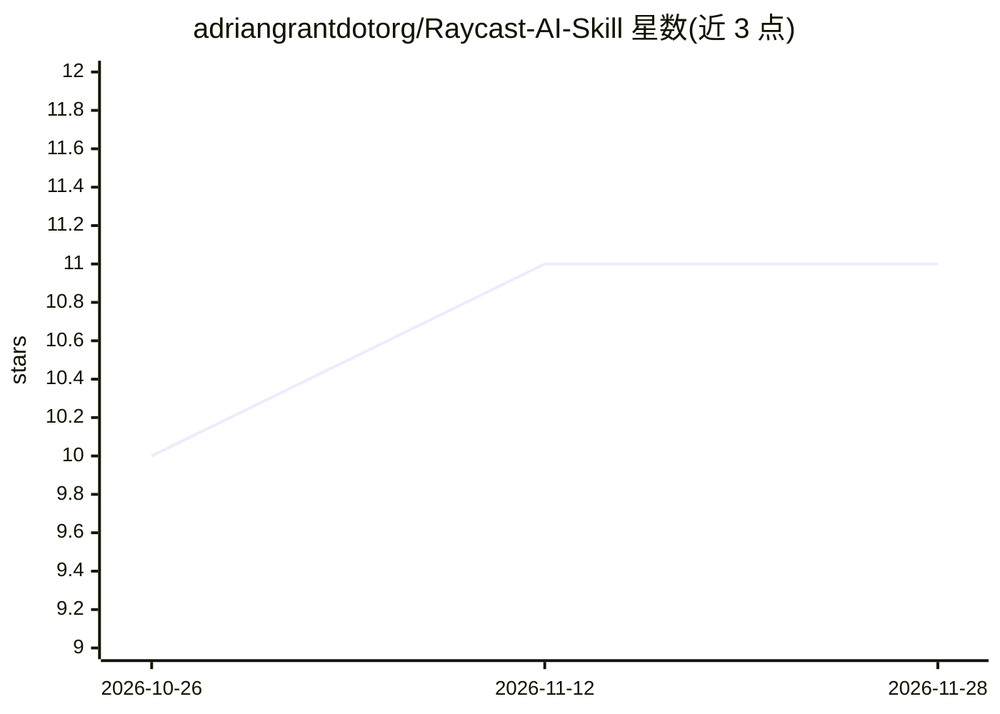

# adriangrantdotorg/Raycast-AI-Skill

⭐ 11 · Python · Apache-2.0 · 推送 2026-11-27 · [GitHub](https://github.com/adriangrantdotorg/Raycast-AI-Skill) · 个人维护

**教 AI 编码助手正确生成 Raycast 命令与扩展的技能包**

一个面向 AI 编码助手的 Agent Skill，内容为 Raycast 开发规则：让 AI 在写代码前先选择最轻量的方案（内置 Quicklink/Snippet、单文件 Script Command 或完整 Extension），覆盖 @raycast.* 配置、@raycast/utils 钩子、加密偏好与 OAuth、Raycast AI 工具调用及读取日志排错；加载时会检查 Raycast 的 npm 发布、文档与手册以保持与 API 2.8.2 同步。通过复制 skills/raycast 目录到 Claude Code、Cursor、ChatGPT & Codex 的技能文件夹安装。

## 筛选速览

| 维度 | 判定 | 备注 |
|---|---|---|
| AI 角色 | `ai-knowledge` | 知识聚合/清单类 |
| 许可风险 | `permissive` | Apache-2.0 |
| 部署形态 | `library` | 以包/库形式分发 |
| 模型依赖 | — | README 未给出锁定关系 |
| 硬件要求 | — | 无带数字的原话,不猜 |
| 安装摩擦 | `low` | 无编译、无系统依赖或容器化 |
| 成熟度 | — | 结构信号不足 |

## 能力要点

- 写代码前按最轻量原则选择 Quicklink/Snippet、Script Command 或 Extension
- 覆盖 @raycast.* 配置细节、@raycast.utils 钩子、加密偏好与 OAuth
- 加载时自动检查 Raycast npm 发布、文档与手册保持规则更新
- 支持 Claude Code / Cursor / ChatGPT & Codex 的 Agent Skills 目录

## 适用场景

- 让 AI 助手一次性生成可用的 Raycast Script Command
- 为 Notion 等服务构建带表单与令牌管理的 Raycast 扩展
- 排查 Raycast 升级后扩展丢失等运行问题

## 场景标签

`编码 Agent` · 领域:编码与开发

## 证据(README 行号)

> L5: > A free skill that teaches your AI coding assistant to build Raycast commands and extensions the right way, the fir
> L40: Needs **Raycast** and an AI assistant that supports Agent Skills. Full Extensions also need **Node.js** 22.22.2+; t

## 星数曲线

2026-10-26 10 → 2026-11-28 11（+1）

---
*卡片 v1 · prompt 1.4 · 生成 2026-11-18 · 置信度 mid · 依据 README sha `cc128aad1e6a` · [字段定义](../../DATASET.md)*
