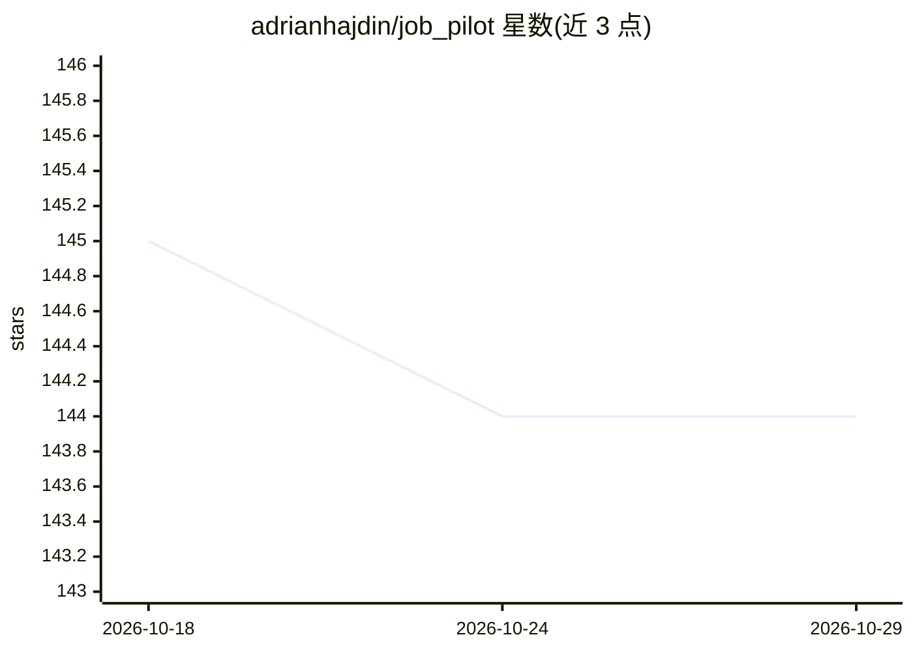

# adrianhajdin/job_pilot

⭐ 144 · TypeScript · 推送 2026-06-06 · [GitHub](https://github.com/adrianhajdin/job_pilot) · [官网](https://jsmastery.com) · 组织维护

**求职者用的 AI Agent：自动找工作、打分匹配并定制简历**

基于 Next.js 的全栈求职代理应用，配套 JavaScript Mastery YouTube 教程。通过 Browserbase 云浏览器与 Stagehand 浏览器代理浏览 LinkedIn、Wellfound、YC Jobs，用 GPT-4o 解析职位描述并按用户画像计算匹配分，生成并针对特定职位定制简历，实验性支持自动提交 LinkedIn Easy Apply 与外部 ATS 表单。数据存储、认证与文件存储由 InsForge 提供，应用内嵌 PostHog 分析，每次自动申请附 Browserbase 录像审计链接。需配置多家服务 API 凭证后 npm 运行。

## 筛选速览

| 维度 | 判定 | 备注 |
|---|---|---|
| AI 角色 | `ai-native` | 本体是模型或模型工具 |
| 许可风险 | `none` | — |
| 部署形态 | `library` | 以包/库形式分发 |
| 模型依赖 | — | README 未给出锁定关系 |
| 硬件要求 | — | 无带数字的原话,不猜 |
| 安装摩擦 | `low` | 无编译、无系统依赖或容器化 |
| 成熟度 | — | 结构信号不足 |

## 能力要点

- 跨 LinkedIn/Wellfound/YC Jobs 发现职位并由 LLM 计算匹配分排序
- 基于用户画像生成简历并按职位描述动态定制
- 实验性自动投递路径：LinkedIn Easy Apply 与外部 ATS 表单填写
- 每次自动申请关联 Browserbase 会话录像供审计

## 适用场景

- 我想让 AI 帮我搜集并匹配技术岗位
- 我想为每个目标岗位快速生成定制简历
- 我想集中管理投递进展与匹配明细

## 场景标签

`浏览器自动化` `AI 写作` · 领域:效率与自动化

## 证据(README 行号)

> L26: JobPilot is an autonomous, full-stack AI agent that transforms how technical job seekers find work by simultaneousl
> L38: - **OpenAI GPT-4o** is a highly capable multimodal AI model that serves as the core intelligence engine, parsing jo
> L54: 👉 **Resume Generation & Tailoring**: Dynamic engine that generates a foundational resume from your user profile, th

## 星数曲线

2026-10-18 145 → 2026-10-29 144（-1）

---
*卡片 v1 · prompt 1.4 · 生成 2026-10-22 · 置信度 high · 依据 README sha `038fde46b34f` · [字段定义](../../DATASET.md)*
