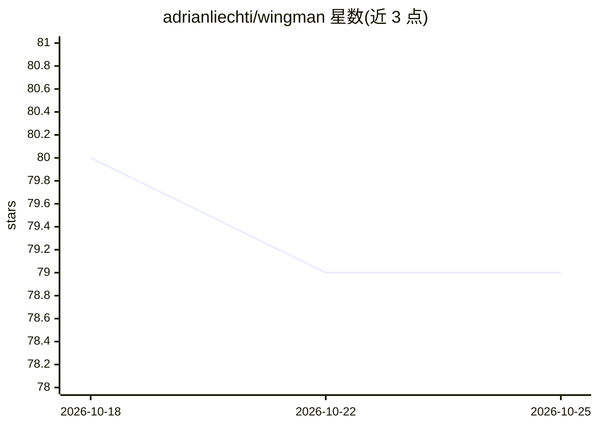

# adrianliechti/wingman

⭐ 79 · Go · MIT · 推送 2026-10-23 · [GitHub](https://github.com/adrianliechti/wingman) · 个人维护

**统一 LLM 推理网关：多供应商与本地运行时单一 API 接入**

开源推理中心，将各大模型厂商（OpenAI/Azure/Anthropic/Gemini/Bedrock/Mistral/xAI/OpenRouter 等）与本地运行时（Ollama、LLAMA.CPP）聚合在 OpenAI/Anthropic/Gemini 兼容的单一 API 之后，通过 YAML 配置即可启用 RAG、agents、工具调用、MCP（服务端与客户端）、路由、负载均衡、限流、OIDC 认证与 OpenTelemetry。支持文档抽取、分段、检索、图像生成、语音转写与合成等能力，各组件均可通过 gRPC 插件扩展。以 Go 实现，通过 task server 或 go run 运行。

## 筛选速览

| 维度 | 判定 | 备注 |
|---|---|---|
| AI 角色 | `ai-ecosystem` | LLM/agent 周边工具 |
| 许可风险 | `permissive` | MIT |
| 部署形态 | `None` |  |
| 模型依赖 | local-ok | 支持本地模型 |
| 硬件要求 | — | 无带数字的原话,不猜 |
| 安装摩擦 | `low` | 无编译、无系统依赖或容器化 |
| 成熟度 | — | 结构信号不足 |

## 能力要点

- 多厂商与本地运行时统一为 OpenAI/Anthropic/Gemini 兼容 API
- RAG、agents、工具调用与 MCP 服务端/客户端内建
- 路由、负载均衡、限流、OIDC 认证与 OpenTelemetry 全链路观测
- 各组件（提取/分段/检索/工具等）支持 gRPC 插件扩展

## 适用场景

- 企业统一接入多家模型供应商并集中管理凭据与限流
- 以配置文件搭建带 RAG 与工具调用的 agent 服务
- 将本地 Ollama/LLAMA.CPP 纳入统一 API 供现有 OpenAI 客户端调用

## 场景标签

`模型网关` `RAG` · 领域:Agent 开发

## 证据(README 行号)

> L5: Wingman is an open-source inference hub that simplifies building and deploying large language model (LLM) applicatio
> L169: Call it with any OpenAI-compatible client — agents appear as regular models:

## 星数曲线

2026-10-18 80 → 2026-10-25 79（-1）

---
*卡片 v1 · prompt 1.4 · 生成 2026-10-24 · 置信度 high · 依据 README sha `3f9d8eda0ec8` · [字段定义](../../DATASET.md)*
