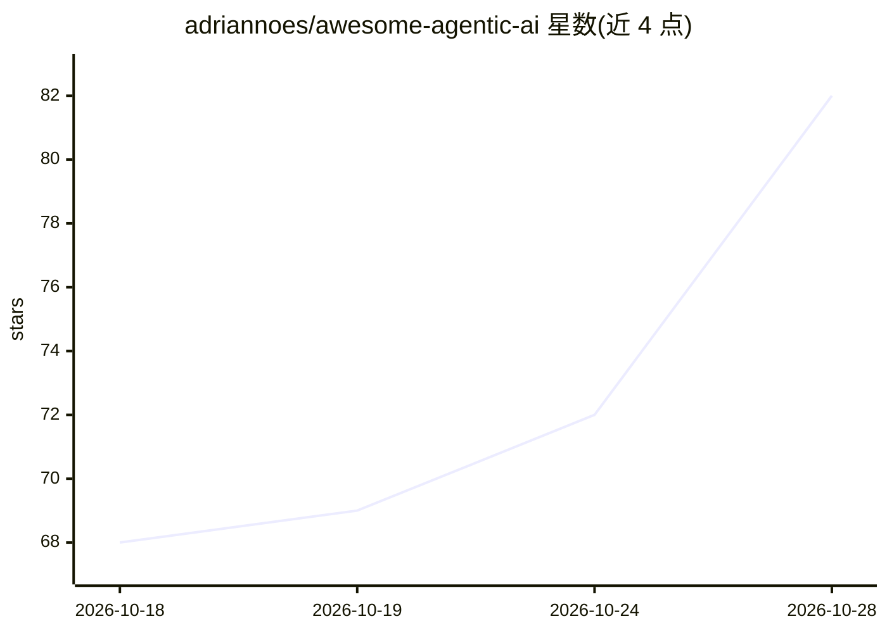

# adriannoes/awesome-agentic-ai

⭐ 88 · Jupyter Notebook · MIT · 推送 2026-10-24 · [GitHub](https://github.com/adriannoes/awesome-agentic-ai) · 个人维护

**面向产品构建者的 AI 辅助开发资源聚合中心（技能/论文/教材）**

一个聚合型学习资源库：收录 403 个面向 Cursor、Claude Code 与 Codex 的 SKILL.md 格式 agent 技能、108 篇论文（11 个主题）、9 本教材、201 个笔记本、18 份行业报告、100 个精选 GitHub 项目与 5,380 个 OpenClaw 技能。设计为将仓库作为工作区打开、由 agent 通过 AGENTS.md 入口直接读取本地资料使用，并提供按 PM/设计师/开发者/学习者划分的路径文档。定位为可直接复制、fork 并当天使用的 hub，MIT 许可。

## 筛选速览

| 维度 | 判定 | 备注 |
|---|---|---|
| AI 角色 | `ai-knowledge` | 知识聚合/清单类 |
| 许可风险 | `permissive` | MIT |
| 部署形态 | `None` |  |
| 模型依赖 | — | README 未给出锁定关系 |
| 硬件要求 | — | 无带数字的原话,不猜 |
| 安装摩擦 | `low` | 无编译、无系统依赖或容器化 |
| 成熟度 | — | 结构信号不足 |

## 能力要点

- 403 个 SKILL.md 技能包，兼容 Cursor / Claude Code / Codex
- 108 篇论文、9 本教材、201 个笔记本、18 份行业报告本地化存放
- agent 经 AGENTS.md 读取本地资料而非联网检索
- 按 PM/设计师/开发者/学习者四类人群提供路径文档

## 适用场景

- 让 Claude Code 或 Cursor 在本仓库工作区中直接调用技能与资料
- 查找 AI 辅助开发的学习路径（论文、教材、报告）
- 浏览精选的 agent 项目与 OpenClaw 技能索引

## 场景标签

`精选清单` `教程课程` · 领域:学习与行业

## 证据(README 行号)

> L14: **What's inside:** **403** agent skills · **108** papers · **201** notebooks · **9** textbooks · **100** curated Gi
> L22: - **Apply skills** already on disk under cursor-claude-codex/skills/ — 403 `SKILL.md` packages for Cursor, Claude C

## 星数曲线

2026-10-18 68 → 2026-10-28 82（+14）

---
*卡片 v1 · prompt 1.4 · 生成 2026-10-24 · 置信度 high · 依据 README sha `1f6f5a5ec865` · [字段定义](../../DATASET.md)*
