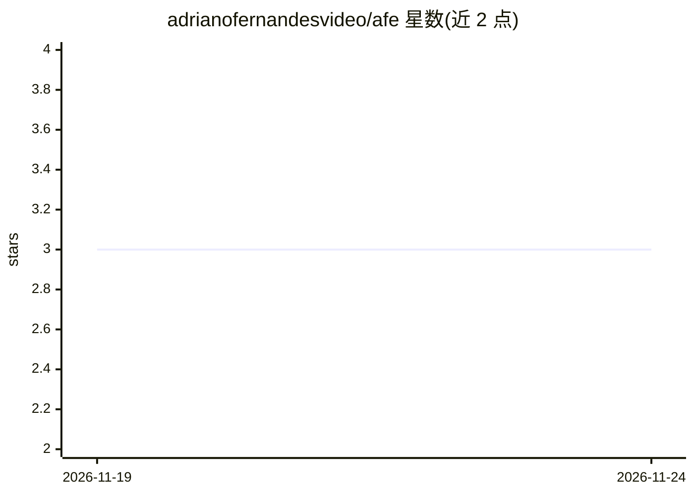

# adrianofernandesvideo/afe

⭐ 3 · JavaScript · AGPL-3.0 · 推送 2026-11-22 · [GitHub](https://github.com/adrianofernandesvideo/afe) · [官网](https://adrianofernandesvideo.github.io/afe/) · 个人维护

**面向设计者的 HTML AI 生成作品可视化编辑器**

AFE 是一款在浏览器中运行的 HTML 作品可视化编辑器，针对固定尺寸的 `.html` 图稿（帖子、轮播、stories、横幅）提供手动调整能力：移动、改字号与文本、光晕阴影、圆角描边、混色模式、胶片颗粒等效果，并支持 keyframes 动画与 MP4 导出（可选 motion blur）。编辑内容写入独立的 `.editions.js` 数据文件，不改动原稿。提供 Windows/macOS/Linux 可执行包、浏览器 live preview 与 Python 源码运行方式。作者自述为设计师而非程序员，项目处于 beta 阶段。

## 筛选速览

| 维度 | 判定 | 备注 |
|---|---|---|
| AI 角色 | `ai-enhanced` | 去掉 AI 部分产品仍成立 |
| 许可风险 | `viral` | AGPL-3.0 |
| 部署形态 | `None` |  |
| 模型依赖 | — | README 未给出锁定关系 |
| 硬件要求 | — | 无带数字的原话,不猜 |
| 安装摩擦 | `medium` | 含编译或系统依赖之一 |
| 成熟度 | `idea` | |

## 能力要点

- 编辑修改写入旁路数据文件（`<arte>.edicoes.js`），删除即恢复原稿
- keyframes 动画编辑（easing 曲线、逐层时间、循环效果）并导出 MP4
- 提供 Windows/macOS/Linux 可执行包与免安装浏览器 live preview
- 附带 `AGENTS.md` 供 Claude/ChatGPT/Cursor 等读取以生成适配编辑器的图稿

## 适用场景

- 手动微调 AI 生成的 HTML 宣传图稿而不碰代码
- 为社交媒体制作带动画的帖子、轮播与 stories
- 通过本地 Python 服务器挂载自有品牌资产库

## 场景标签

 · 领域:设计/创意工具

## 证据(README 行号)

> L16: Editor visual para artes feitas em HTML — posts, carrosséis, stories, banners. Você abre a arte no
> L41: - **Pelo executável (Releases):** só um navegador (Edge ou Chrome). Não precisa de Python.
> L42: - **Pelo código:** Python 3 (o servidor usa só a biblioteca padrão) e um navegador Edge ou Chrome.

## 星数曲线

2026-11-19 3 → 2026-11-24 3（+0）

---
*卡片 v1 · prompt 1.4 · 生成 2026-11-22 · 置信度 high · 依据 README sha `e646cd12e9f8` · [字段定义](../../DATASET.md)*
