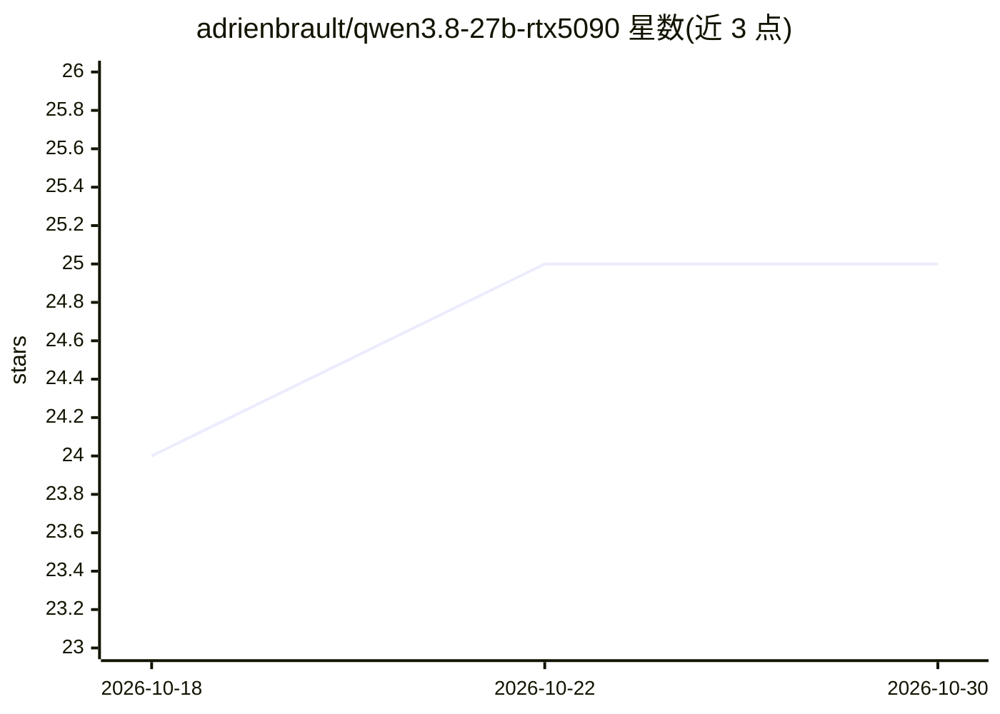

# adrienbrault/qwen3.8-27b-rtx5090

⭐ 25 · Python · NOASSERTION · 推送 2026-10-21 · [GitHub](https://github.com/adrienbrault/qwen3.8-27b-rtx5090) · 个人维护

**在 2×RTX 5090 上服务 Qwen3.8-27B 的配置与测量记录**

面向本地推理的配置档案（recipe card）：以 vLLM v0.31.0 加补丁链、FlashInfer 0.7.0.post1 在两张 RTX 5090 上运行 NVFP4 量化的 nvidia/Qwen3.8-27B，262,144 token 窗口、NVFP4 KV 缓存、MTP 3-token 投机解码，目标负载为少量并发的长上下文编码 agent。仓库提供启动脚本、补丁、镜像构建脚本与解码/预填充/KV 池/功耗的测量数据，KV 池后接 16 GiB 内存与 300 GB 磁盘两级分层；测量均来自单台机器在标注日期的结果目录。

## 筛选速览

| 维度 | 判定 | 备注 |
|---|---|---|
| AI 角色 | `ai-ecosystem` | LLM/agent 周边工具 |
| 许可风险 | `none` | NOASSERTION |
| 部署形态 | `self-host` | docker 或自建部署 |
| 模型依赖 | local-ok | 支持本地模型 |
| 硬件要求 | — | 无带数字的原话,不猜 |
| 安装摩擦 | `low` | 无编译、无系统依赖或容器化 |
| 成熟度 | — | 结构信号不足 |

## 能力要点

- vLLM v0.31.0 + patches-v0310 补丁链 + FlashInfer 的完整服务配置
- NVFP4 KV 缓存（每卡 15.90 GB，1,490,437 token）与两级 KV 分层（16 GiB 内存 + 300 GB 磁盘 LRU）
- MTP 3-token 投机解码，接受率 0.46-0.68
- 解码/预填充/TTFT/容量算术均有可溯源的测量记录

## 适用场景

- 复现双 RTX 5090 上 Qwen3.8-27B 的服务部署
- 为本地长上下文编码 agent 选择 KV 池与并发容量参数
- 参考 NVFP4 量化与投机解码在消费级 GPU 上的性能数据

## 场景标签

`推理引擎` `模型量化` · 领域:训练与推理

## 证据(README 行号)

> L5: Serving configuration, vLLM patches, launch scripts and measurements for Qwen3.8-27B, served as nvidia/Qwen3.8-27B-N
> L43: - Weights nvidia/Qwen3.8-27B-NVFP4, image `vllm-qwen38:v0310-r27c-A_S-BA4-L1a-ubplan` (vLLM v0.31.0, patches-v0310/
> L65:  - patches-v0310/README.md describes the four builds behind the served image; scripts/build-served-image.sh builds 

## 星数曲线

2026-10-18 24 → 2026-10-30 25（+1）

---
*卡片 v1 · prompt 1.4 · 生成 2026-10-27 · 置信度 mid · 依据 README sha `05a7216ce109` · [字段定义](../../DATASET.md)*
