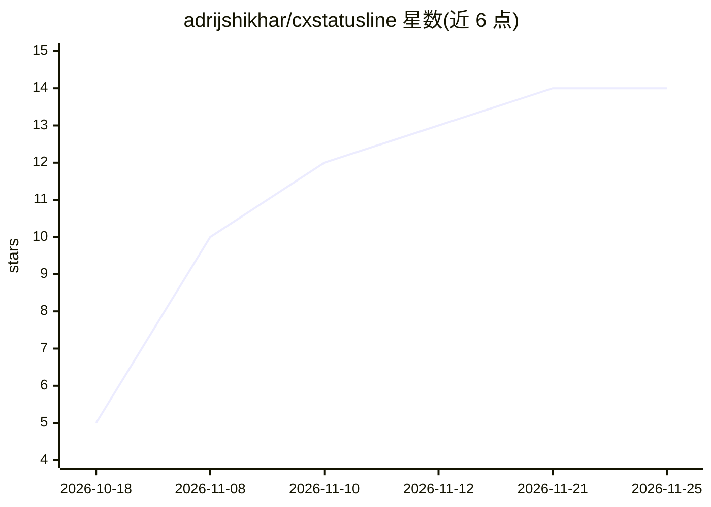

# adrijshikhar/cxstatusline

⭐ 14 · TypeScript · MIT · 推送 2026-11-23 · [GitHub](https://github.com/adrijshikhar/cxstatusline) · [官网](https://cxstatusline.adrijshikhar.dev/) · 个人维护

**为 OpenAI Codex CLI 提供可定制终端状态栏与实时遥测**

一个面向 OpenAI Codex CLI 的状态行/状态栏工具：通过给 codex-tui 打附加式 Rust 补丁提取会话遥测（模型、上下文 token、Git 分支、速率限制重置倒计时），经 stdio 发送至本地 TypeScript ANSI 渲染器显示。提供交互式 TUI 配置器、36 个内置组件、Powerline 主题与 Web Playground 预览。需已有 Codex CLI 安装、Node.js 22+，支持 macOS 14+/Linux；更新采用代际目录与原子符号链接切换，提供 revert 命令还原原始 Codex 二进制。

## 筛选速览

| 维度 | 判定 | 备注 |
|---|---|---|
| AI 角色 | `ai-ecosystem` | LLM/agent 周边工具 |
| 许可风险 | `permissive` | MIT |
| 部署形态 | `library` | 以包/库形式分发 |
| 模型依赖 | — | README 未给出锁定关系 |
| 硬件要求 | — | 无带数字的原话,不猜 |
| 安装摩擦 | `low` | 无编译、无系统依赖或容器化 |
| 成熟度 | — | 结构信号不足 |

## 能力要点

- 36 个内置组件：token 速度、会话时钟、Git diff 统计、自定义 shell 命令输出
- 交互式终端 TUI 配置与 Web Playground 浏览器预览
- 基于 Rust 补丁的 additive 方案，代际目录+原子符号链接切换保证会话不被中断
- revert 命令可随时还原未修改的 Codex 二进制

## 适用场景

- 在终端状态栏实时查看 Codex 会话的上下文 token 与速率限制倒计时
- 按喜好定制 Powerline 主题与状态栏布局
- 查看当前分支与未暂存/已暂存变更计数

## 场景标签

 · 领域:开发者工具/CLI 增强

## 证据(README 行号)

> L21: **cxstatusline** is a configurable, multi-row statusline & status bar for the OpenAI Codex CLI.
> L120: OpenAI Codex does not yet provide a native statusline extension API (openai/codex#17827). `cxstatusline` bridges t

## 星数曲线

2026-10-18 5 → 2026-11-25 14（+9）

---
*卡片 v1 · prompt 1.4 · 生成 2026-11-18 · 置信度 high · 依据 README sha `43f87529fa14` · [字段定义](../../DATASET.md)*
