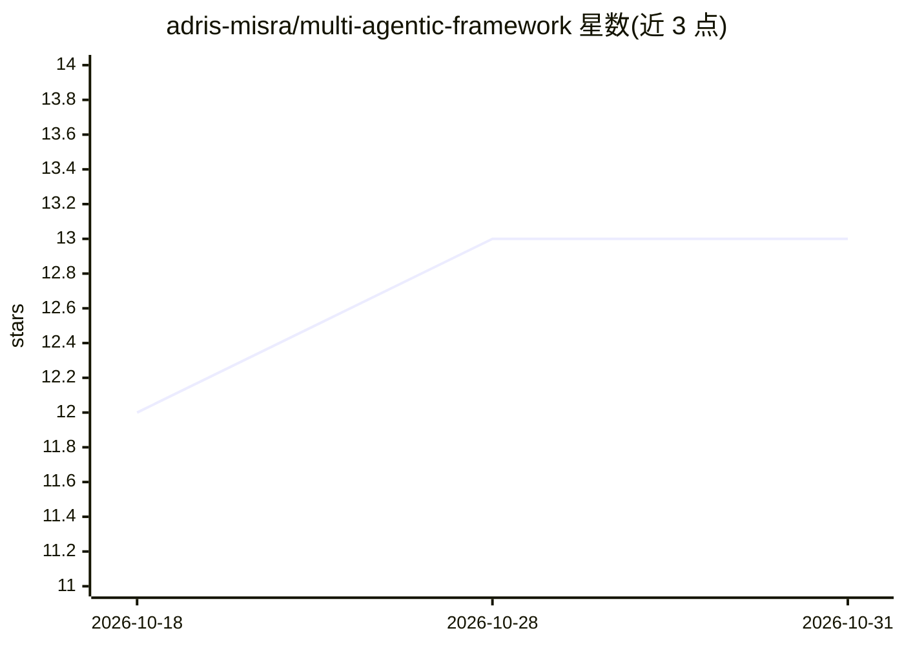

# adris-misra/multi-agentic-framework

⭐ 13 · Python · MIT · 推送 2026-07-27 · [GitHub](https://github.com/adris-misra/multi-agentic-framework) · [官网](https://adris-misra.github.io/multi-agentic-framework/) · 个人维护

**面向美国中小制造商的 UNS 多智能体参考架构，对齐 ISA-95/CMMC L2**

开源参考架构：十个专职 agent（意图解析、UNS 上下文代理、遥测读取、异常归因、RAG 知识策展、OPA 安全护栏、工单派发、治理溯源、HITL 监督、Streamlit 操作界面）通过 UNS 中介的群组协作，读取 OPC UA、MQTT Sparkplug B、PI、Snowflake 等工业数据源。面向美国中小制造商、国防分包商与研究机构。支持 Ollama 本地笔记本模式，可扩展到 AWS Bedrock 或 Azure OpenAI；基准结果标注 TBD，尚未发布。

## 筛选速览

| 维度 | 判定 | 备注 |
|---|---|---|
| AI 角色 | `ai-ecosystem` | LLM/agent 周边工具 |
| 许可风险 | `permissive` | MIT |
| 部署形态 | `self-host` | docker 或自建部署 |
| 模型依赖 | local-ok | 支持本地模型 |
| 硬件要求 | — | 无带数字的原话,不猜 |
| 安装摩擦 | `low` | 无编译、无系统依赖或容器化 |
| 成熟度 | `idea` | |

## 能力要点

- 10 个专职 agent 经 UNS Context Broker 中介协作，实施 Purdue 分区强制
- 读取 OPC UA / MQTT Sparkplug B / PI / Ignition / Snowflake / Timestream
- OPA 策略门控 + Ed25519 签名审计 + NIST AI RMF 映射
- SMM 笔记本模式：Ollama 本地推理，无需云端

## 适用场景

- 中小制造商在车间用自然语言查询运营知识
- 国防供应链分包商构建 CMMC L2 对齐的可审计 agent 系统
- 研究机构使用 IABENCH-v1 与合成 UNS 数据集开展工业 agentic AI 研究

## 场景标签

`多智能体` `RAG` · 领域:Agent 开发

## 证据(README 行号)

> L94: Ten specialized agents collaborate in a UNS-mediated group chat, governed end-to-end by an immutable lineage bus:
> L38: framework gives them a reference architecture deployable on a laptop with

## 星数曲线

2026-10-18 12 → 2026-10-31 13（+1）

---
*卡片 v1 · prompt 1.4 · 生成 2026-10-31 · 置信度 high · 依据 README sha `4d8a59311531` · [字段定义](../../DATASET.md)*
