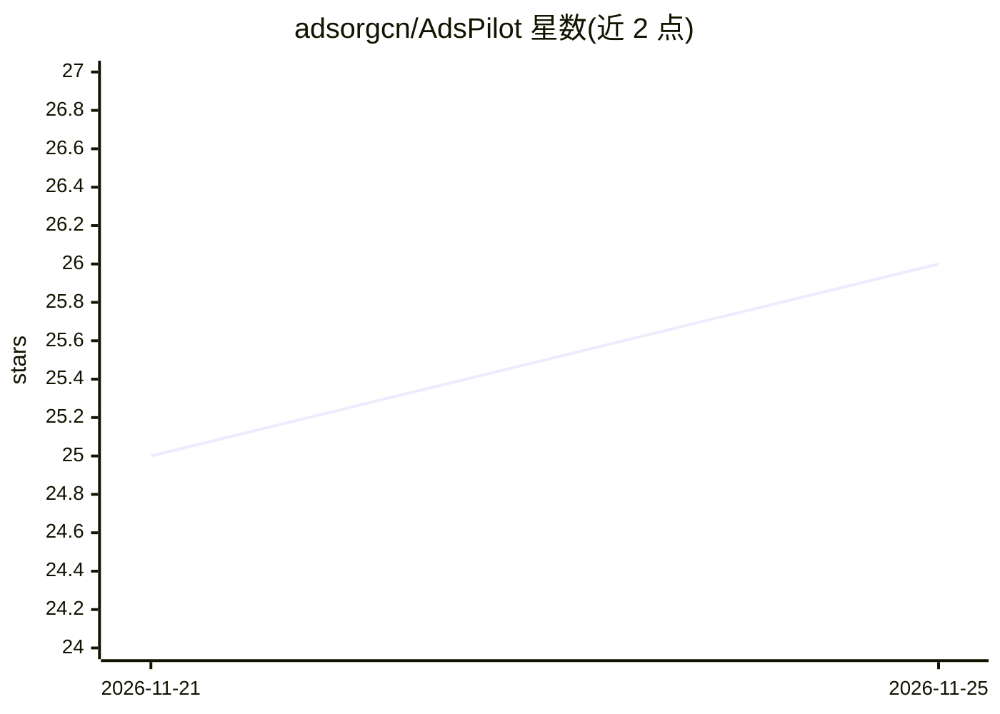

# adsorgcn/AdsPilot

⭐ 26 · Python · MIT · 推送 2026-11-23 · [GitHub](https://github.com/adsorgcn/AdsPilot) · [官网](https://ilang.ai) · 个人维护 · 中文 README

**广告联盟 SEM/PPC 投放基座与插件，交给自有 Agent 无人值守运行**

将搜索广告（Google Ads）与广告联盟（CJ、Impact）投放能力拆成主干加插件：主干含 Agent 适配、开局、落地页、判断（f_v5 冻结）、归因对账与无人值守循环，插件封装对外 API 调用。通过 39 个 JSON/MCP 工具与 npm 包 `adspilot` 供 DeepSeek Harness、Claude Code 等 MCP 客户端调用；脚本仅用 Python 标准库，无后台与账号系统。写入外部平台须显式 `--apply` 且配置布尔开关同时开启。合规姿态声明：单账号、不模拟点击、凭据零留存。

## 筛选速览

| 维度 | 判定 | 备注 |
|---|---|---|
| AI 角色 | `ai-native` | 本体是模型或模型工具 |
| 许可风险 | `permissive` | MIT |
| 部署形态 | `library` | 以包/库形式分发 |
| 模型依赖 | — | README 未给出锁定关系 |
| 硬件要求 | — | 无带数字的原话,不猜 |
| 安装摩擦 | `low` | 无编译、无系统依赖或容器化 |
| 成熟度 | — | 结构信号不足 |

## 能力要点

- 39 个标准 JSON/MCP 工具，CLI 与 MCP 共用同一接口
- iLang v5 判断层输出 M1–M8 建议，仅 M1/M2 自动执行
- 双开关写门控（--apply 且配置布尔 true）控制外部写入
- Google Ads、CJ、Impact、Cloudflare 插件均有真实账号实测记录

## 适用场景

- 让自有 Agent 在本人 Google Ads 与 CJ/Impact 账号上每日跑投放循环
- 拉取点击与佣金明细做 gclid 级归因对账并回传转化
- Cloudflare 一键搭建落地页与追踪跳转

## 场景标签

`工作流自动化` · 领域:效率与自动化

## 证据(README 行号)

> L3: **开源、免费。** 把整套搜索广告（SEM / PPC）与广告联盟（CJ、Impact）投放能力做成基座加插件，交给你自己的 Agent（DeepSeek Harness、Claude Code、Codex、Cursor、Open
> L13: AdsPilot 反过来，是「你的 Agent 替你干活」。仓库里没有一个要编译的程序、没有后台、没有账号系统。它是一套写给 Agent 看的使用方法，加一组只用 Python 标准库的小脚本（同时提供 39 个标准 JSON /

## 星数曲线

2026-11-21 25 → 2026-11-25 26（+1）

---
*卡片 v1 · prompt 1.4 · 生成 2026-11-21 · 置信度 mid · 依据 README sha `d92940718824` · [字段定义](../../DATASET.md)*
