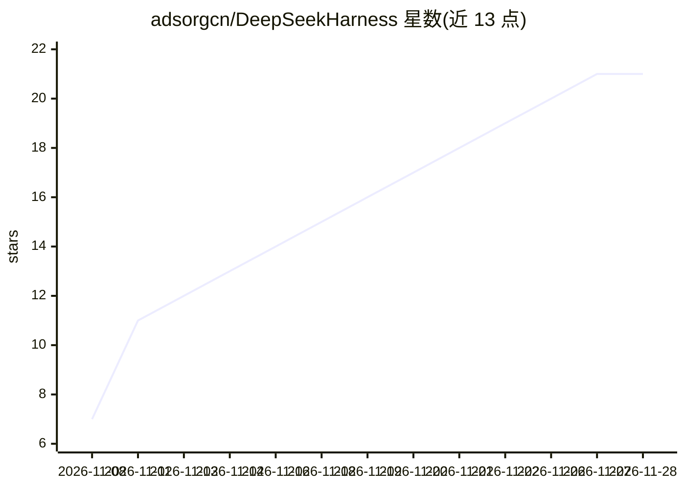

# adsorgcn/DeepSeekHarness

⭐ 21 · Python · MIT · 推送 2026-11-26 · [GitHub](https://github.com/adsorgcn/DeepSeekHarness) · [官网](https://dsh.ilang.guide/) · 个人维护 · 中文 README

**给 DeepSeek Harness 用户装本地记忆、技能与一键安装的工具包**

由 iLang 开发、面向 DeepSeek Harness（DSH）用户的开源工具包，含四个部分：以本地文件保存习惯与决定的记忆体（每笔记忆对应一次 git 提交）；四句话新手教程（配模型默认 deepseek-flash）；按系统选择 bootstrap.ps1/bootstrap.sh 的一键安装脚本（逐项征询同意、只走官方源，GitHub 不可达时走 Gitee 镜像）；以 mem-forever 等起步的技能库与技能市场。另提供 MCP 只读服务供 Agent 查询安装说明与技能市场。README 声明在 DSH 0.2.2-rc.1 上验证，DSH 处于 Developer Preview。

## 筛选速览

| 维度 | 判定 | 备注 |
|---|---|---|
| AI 角色 | `ai-ecosystem` | LLM/agent 周边工具 |
| 许可风险 | `permissive` | MIT |
| 部署形态 | `None` |  |
| 模型依赖 | locked-api |  |
| 硬件要求 | — | 无带数字的原话,不猜 |
| 安装摩擦 | `low` | 无编译、无系统依赖或容器化 |
| 成熟度 | — | 结构信号不足 |

## 能力要点

- 记忆体以本地文件存储，每笔记忆对应一次 git 提交形成哈希链
- Windows/macOS/Linux 各有 bootstrap 脚本，逐项确认后从官方源安装
- GitHub 不可达时自动走 Gitee 国内镜像
- 提供无需账号的 MCP 只读服务（5 个工具：安装指引、文档检索、技能市场查询等）

## 适用场景

- 让 DeepSeek Harness 跨窗口记住我的进度和偏好
- 在新电脑上通过一句话完成环境安装与配置
- 为我的 DSH 按需加装技能并查询技能市场

## 场景标签

`Agent 记忆` `教程课程` · 领域:Agent 开发

## 证据(README 行号)

> L12: iLang 开发、面向 DeepSeek Harness 用户的开源工具包，提供本地记忆、新手教程、一键安装和技能库。
> L38: **记忆体** · 窗口关了，进度还在。你的习惯、决定、规矩写成本地文件；换窗口不忘，换电脑贴一句「把我的记忆体备份到我自己的私有仓库」。每笔记忆 = 一次 git 提交，哈希链就是防伪链。
> L116: 将 Windows 换成 macOS 或 Linux，即可获取对应系统的指引。连接后可发现 5 个工具：产品概览、安装指引、文档检索、单篇文档读取和技能市场查询。安装由你的本地 Agent 按你的确认执行；这个公开服务不能访问本

## 星数曲线

2026-11-08 7 → 2026-11-28 21（+14）

---
*卡片 v1 · prompt 1.4 · 生成 2026-11-18 · 置信度 high · 依据 README sha `99f19550b72f` · [字段定义](../../DATASET.md)*
