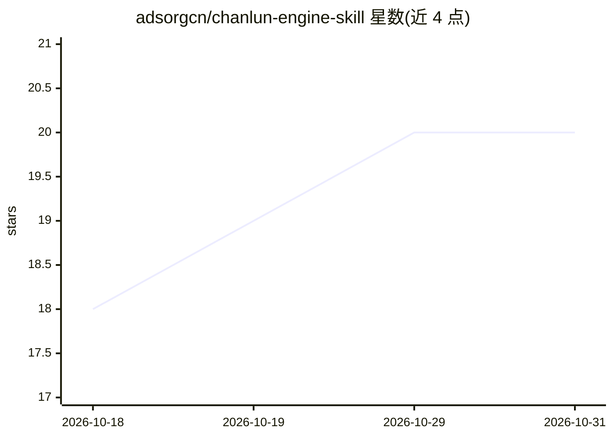

# adsorgcn/chanlun-engine-skill

⭐ 20 · Python · MIT · 推送 2026-08-25 · [GitHub](https://github.com/adsorgcn/chanlun-engine-skill) · [官网](https://ilang.app) · 个人维护 · 中文 README

**让 AI 助手对 A 股做缠论结构分析与买卖点判定的技能包**

把缠中说禅《教你炒股票》108 课的分型、笔、线段、中枢、三类买卖点、背驰等结构做成确定性引擎：脚本完成包含处理与画线计算，输出买卖点候选与带失效价位的操作判定，AI 助手负责解读。适配 WorkBuddy/Claude Code/Codex/OpenClaw。数据源支持 akshare 免费行情或同花顺 key，也可直接喂日K CSV。限制：仅日-周两级近似，信号为候选非确认，不构成投资建议。

## 筛选速览

| 维度 | 判定 | 备注 |
|---|---|---|
| AI 角色 | `ai-native` | 本体是模型或模型工具 |
| 许可风险 | `permissive` | MIT |
| 部署形态 | `library` | 以包/库形式分发 |
| 模型依赖 | — | README 未给出锁定关系 |
| 硬件要求 | — | 无带数字的原话,不猜 |
| 安装摩擦 | `low` | 无编译、无系统依赖或容器化 |
| 成熟度 | — | 结构信号不足 |

## 能力要点

- 确定性引擎自动画笔、线段、中枢并标出三类买卖点与失效价位
- 程序算结构、AI 只负责解读，同一数据结果可复核
- 5000 只 A 股约 2 分钟全市场缠论选股扫描
- 免费 akshare 行情源即装即用，支持同花顺 key 与任意日K CSV

## 适用场景

- 让 AI 助手帮我分析某只 A 股的缠论结构和买卖点
- 全市场扫描筛出最近出现买卖点的候选股票
- 持仓时获得带失效价位的持有/卖出判定参考

## 场景标签

`金融量化` · 领域:学习与行业

## 证据(README 行号)

> L5: 把缠中说禅《教你炒股票》108 课里的核心结构（分型、笔、线段、中枢、三类买卖点、背驰）做成了确定性程序。你的 AI 助手（WorkBuddy、Claude Code、Codex、OpenClaw）装上这个技能后，就能对任意一只 A
> L26: 我们对拍过：两套确定性引擎在同一份K线上，**中枢对齐率只有 0.0-0.42**。缠论结构对算法口径极其敏感，让大模型每次现场心算，结论会天天漂移、无法复核。所以这个技能的铁律是：**程序算结构，AI 只负责解读**。哪怕你用的
> L58: - 基于**日K**：日-周两级近似缠论，没有分钟级次级别确认，所以信号是"候选"不是"确认"，最新买卖点次日可能消失

## 星数曲线

2026-10-18 18 → 2026-10-31 20（+2）

---
*卡片 v1 · prompt 1.4 · 生成 2026-10-28 · 置信度 high · 依据 README sha `a3be8277d3d9` · [字段定义](../../DATASET.md)*
