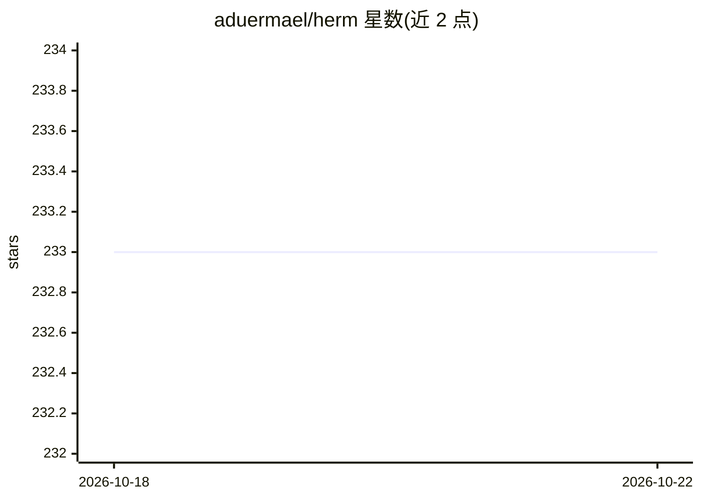

# aduermael/herm

⭐ 233 · Go · MIT · 推送 2026-08-12 · [GitHub](https://github.com/aduermael/herm) · [官网](https://hermagent.com) · 个人维护

**终端 AI 编码代理，默认容器化隔离运行**

Herm 是模型无关的通用 AI 代理，以 CLI 与 iOS/macOS 应用两种形态提供。CLI 默认在 Docker 容器内运行并按项目自动编写 Dockerfile 构建开发环境，仅访问当前工作目录，无需权限确认；也支持进程内 Unix 类沙箱与 macOS sandbox_exec、Linux bubblewrap 等宿主沙箱。支持 Anthropic、OpenAI、Gemini、Grok、OpenRouter、Ollama、Azure OpenAI、Vertex AI、Bedrock 等多提供商混搭。iOS/macOS 版为原生应用，含 Luau 脚本运行时与进程内沙箱，尚未上架 App Store。

## 筛选速览

| 维度 | 判定 | 备注 |
|---|---|---|
| AI 角色 | `ai-native` | 本体是模型或模型工具 |
| 许可风险 | `permissive` | MIT |
| 部署形态 | `self-host` | docker 或自建部署 |
| 模型依赖 | local-ok | 支持本地模型 |
| 硬件要求 | — | 无带数字的原话,不猜 |
| 安装摩擦 | `low` | 无编译、无系统依赖或容器化 |
| 成熟度 | `idea` | |

## 能力要点

- 默认容器化隔离，按项目动态编写 Dockerfile 自建环境
- 多提供商支持且可混搭不同模型分工
- 系统提示词、技能、工具全部开源可复刻
- 另有 iOS/macOS 原生应用，含进程内沙箱与 Luau 脚本运行时

## 适用场景

- 在终端中让 AI 代理在隔离容器里执行编码任务
- 需要无权限打断、限制文件访问范围的自动化开发环境
- 在 Apple 设备上本地运行可脚本化的沙箱代理

## 场景标签

 · 领域:AI 编程代理/开发者工具

## 证据(README 行号)

> L7: Herm is a model-agnostic, general-purpose AI agent built for safe, flexible execution. It natively supports multiple
> L17: **Containerized by default:** Use the CLI on your host; the agent itself runs inside Docker containers and can only
> L19: **Multi-provider** — Anthropic, OpenAI, Gemini, Grok, OpenRouter, Ollama, Azure OpenAI, Vertex AI, or Bedrock… You 

## 星数曲线

2026-10-18 233 → 2026-10-22 233（+0）

---
*卡片 v1 · prompt 1.4 · 生成 2026-10-22 · 置信度 mid · 依据 README sha `65523e3e9e19` · [字段定义](../../DATASET.md)*
