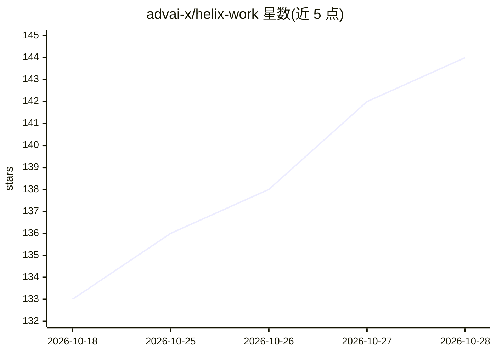

# advai-x/helix-work

⭐ 147 · 推送 2026-09-30 · [GitHub](https://github.com/advai-x/helix-work) · [官网](https://helixwork.net) · 组织维护 · 中文 README

**macOS 通用 AI 工作台：多模型驱动任务执行与产物审阅**

面向 macOS 的桌面 AI 工作台：以任务为起点，在本地项目工作区内读取/创建文档、报告、演示、代码等产物，集成终端、浏览器式研究与预览。支持多家云厂商（OpenAI、Anthropic、Azure OpenAI、Gemini、DeepSeek、DashScope、Moonshot、Z.AI、火山方舟）、OpenRouter、Ollama 本地模型及 OpenAI 兼容自定义网关，可切换模型。执行记录、工具活动与交付文件可在应用内检查。经 GitHub Releases（公证 dmg）与 Mac App Store 分发，仓库不含应用源码，功能受账号权限与地区限制。

## 筛选速览

| 维度 | 判定 | 备注 |
|---|---|---|
| AI 角色 | `ai-native` | 本体是模型或模型工具 |
| 许可风险 | `none` | — |
| 部署形态 | `desktop` | 安装包/桌面程序 |
| 模型依赖 | local-ok | 支持本地模型 |
| 硬件要求 | — | 无带数字的原话,不猜 |
| 安装摩擦 | `low` | 无编译、无系统依赖或容器化 |
| 成熟度 | — | 结构信号不足 |

## 能力要点

- 多提供商接入：OpenAI/Anthropic/Azure/Gemini/DeepSeek/DashScope 等云厂商与 OpenRouter
- Ollama 本地模型与 OpenAI 兼容企业网关支持
- Skills、Plugins 与 MCP 兼容集成扩展工作流
- 执行记录、工具活动与交付产物可在应用内检查

## 适用场景

- 在本地项目中运行 AI 辅助任务并生成/修改文档与代码
- 在同一工作台内切换不同厂商模型完成不同任务
- 审查 AI 任务的执行过程与产出文件后再交付

## 场景标签

`AI 助手` · 领域:对话与助手

## 证据(README 行号)

> L7: Helix Work is a desktop workspace for getting substantial work done with AI. Start with a task, give Helix access to
> L44: - **OpenAI**, **Anthropic**, **Azure OpenAI**, and **Google Gemini**

## 星数曲线

2026-10-18 133 → 2026-10-28 144（+11）

---
*卡片 v1 · prompt 1.4 · 生成 2026-10-22 · 置信度 high · 依据 README sha `5acbb5b9af65` · [字段定义](../../DATASET.md)*
