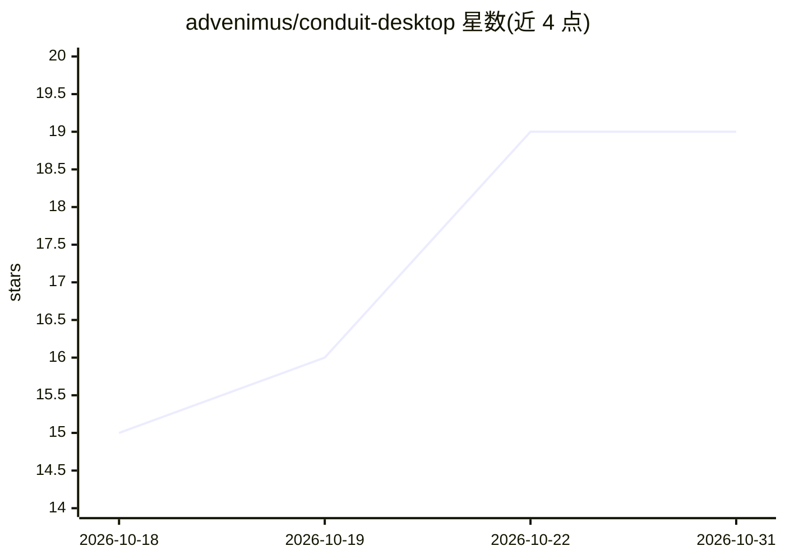

# advenimus/conduit-desktop

⭐ 19 · TypeScript · Apache-2.0 · 推送 2026-10-28 · [GitHub](https://github.com/advenimus/conduit-desktop) · [官网](https://conduitdesktop.com) · 组织维护

**供 AI agent（Claude Code/Codex）驱动的跨平台远程连接管理器**

Electron 桌面应用，管理 SSH、RDP、VNC 与 Web 会话，凭据存于本地 AES-256 加密保险库。内置 MCP 服务器，暴露 60+ 工具（执行命令、截屏点击、读取凭据等），Claude Code 或 Codex 可通过本地 socket 挂载后操作这些连接。不自带模型、不代理 AI 调用，用户用自己的订阅与 API 凭证。面向 DevOps、系统管理员与 AI-first 工程师；客户端 Apache 2.0 开源，团队保险库为 Pro 付费功能，支持从 Devolutions RDM 导入。

## 筛选速览

| 维度 | 判定 | 备注 |
|---|---|---|
| AI 角色 | `ai-enhanced` | 去掉 AI 部分产品仍成立 |
| 许可风险 | `permissive` | Apache-2.0 |
| 部署形态 | `desktop` | 安装包/桌面程序 |
| 模型依赖 | locked-api |  |
| 硬件要求 | — | 无带数字的原话,不猜 |
| 安装摩擦 | `low` | 无编译、无系统依赖或容器化 |
| 成熟度 | — | 结构信号不足 |

## 能力要点

- 内置 MCP 服务器暴露 60+ 工具，覆盖终端/RDP/VNC/Web 操作
- 本地 AES-256 加密凭据库，含 TOTP、SSH 密钥管理与自动锁定
- 工具调用逐项审批、敏感参数脱敏、120 秒自动拒绝与审计日志
- 跨平台构建：macOS/Windows/Linux，x64 与 ARM64

## 适用场景

- 让 Claude Code 或 Codex 在我的服务器上执行命令、操作远程桌面
- 统一管理 SSH/RDP/VNC/Web 多协议会话与凭据
- 团队间零知识共享凭据（Pro 功能）
- 从 Devolutions RDM 迁移已有连接配置

## 场景标签

`GUI 自动化` `浏览器自动化` · 领域:效率与自动化

## 证据(README 行号)

> L13: What makes it different: Conduit ships a **Model Context Protocol (MCP) server** that exposes every connection, eve
> L15: Conduit does not ship its own AI. You bring your own: **Claude Code** (Anthropic) or **Codex** (OpenAI), using your

## 星数曲线

2026-10-18 15 → 2026-10-31 19（+4）

---
*卡片 v1 · prompt 1.4 · 生成 2026-10-28 · 置信度 high · 依据 README sha `0bcd4a4c96d6` · [字段定义](../../DATASET.md)*
