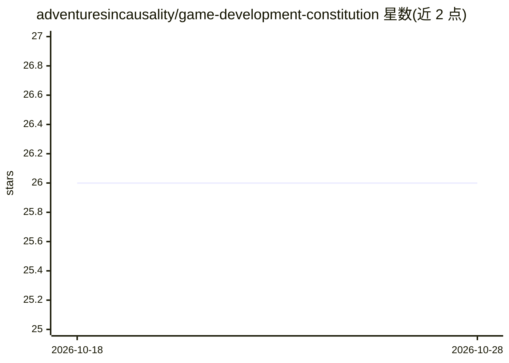

# adventuresincausality/game-development-constitution

⭐ 26 · TypeScript · NOASSERTION · 推送 2026-09-18 · [GitHub](https://github.com/adventuresincausality/game-development-constitution) · [官网](https://adventuresincausality.com/) · 个人维护

**游戏开发原则知识库：146 条证据标注的引擎无关原则**

将分散的游戏开发经验整理为 146 条有边界的、引擎无关的原则，覆盖 24 个领域；每条区分客观/情境/风格建议类型，标注置信度、适用范围、例外与从业者分歧，并附经审阅的来源注册表。面向人类读者提供网站搜索与 PDF/Word 手册，面向 AI 系统提供 principles.json/jsonl 与 manifest 的机器可读语料；另含 Unreal Engine 5.8 专项库（30 个 AI 技能）。内容 CC BY 4.0，网站代码 MIT。

## 筛选速览

| 维度 | 判定 | 备注 |
|---|---|---|
| AI 角色 | `ai-knowledge` | 知识聚合/清单类 |
| 许可风险 | `none` | NOASSERTION |
| 部署形态 | `desktop` | 安装包/桌面程序 |
| 模型依赖 | — | README 未给出锁定关系 |
| 硬件要求 | — | 无带数字的原话,不猜 |
| 安装摩擦 | `low` | 无编译、无系统依赖或容器化 |
| 成熟度 | — | 结构信号不足 |

## 能力要点

- 146 条原则覆盖 24 个游戏开发领域，含稳定 ID 与 YAML front matter
- 区分 objective/contextual/stylistic 三类建议，标注置信度、例外与分歧
- 提供 Markdown/JSON/JSONL/manifest 等面向 AI 检索的机器可读语料
- 30 个 Unreal Engine 5.8 子系统技能与本地 AI bundle

## 适用场景

- 游戏开发者按领域查找有出处、有边界的设计与开发建议
- AI agent 检索游戏开发原则用于决策支持
- 离线阅读 PDF/Word 版或下载 Unreal 5.8 专项手册

## 场景标签

`知识库管理` · 领域:知识与检索

## 证据(README 行号)

> L7: **A searchable, evidence-tagged field guide for people and AI making games.**
> L19: - 146 principles across 24 game-development domains
> L36: For AI systems, the generated corpus is available as:

## 星数曲线

2026-10-18 26 → 2026-10-28 26（+0）

---
*卡片 v1 · prompt 1.4 · 生成 2026-10-26 · 置信度 high · 依据 README sha `7ab70340b988` · [字段定义](../../DATASET.md)*
