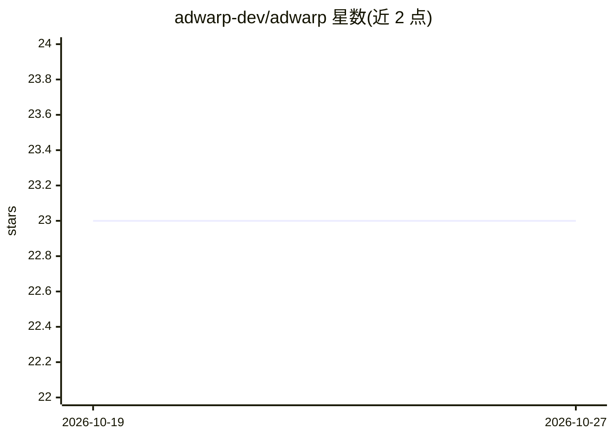

# adwarp-dev/adwarp

⭐ 23 · TypeScript · MIT · 推送 2026-10-23 · [GitHub](https://github.com/adwarp-dev/adwarp) · [官网](https://adwarp.dev) · 组织维护

**对话式操作 LinkedIn/Google 广告的开源 agent（MCP + CLI）**

面向 go-to-market 团队的广告代理工具：以 MCP 服务器（stdio/托管 HTTP）接入 Claude Code、Claude Desktop、Cursor、Codex、Gemini 等客户端，用自然语言完成广告系列创建、受众上传（CSV/Salesforce/HubSpot）、转化选择、报表、竞品广告情报，也可只用全局 adwarp CLI 脚本化批量执行。默认安全策略：LinkedIn 实体建为草稿、Google 实体建为暂停，上线需显式操作；每次写入记录到本地变更日志。Google Ads 仅支持搜索广告。需自建 LinkedIn 开发者应用与 Google 开发者令牌，Node.js 20+。非官方，与 LinkedIn/Google 无隶属。

## 筛选速览

| 维度 | 判定 | 备注 |
|---|---|---|
| AI 角色 | `ai-enhanced` | 去掉 AI 部分产品仍成立 |
| 许可风险 | `permissive` | MIT |
| 部署形态 | `self-host` | docker 或自建部署 |
| 模型依赖 | — | README 未给出锁定关系 |
| 硬件要求 | — | 无带数字的原话,不猜 |
| 安装摩擦 | `low` | 无编译、无系统依赖或容器化 |
| 成熟度 | — | 结构信号不足 |

## 能力要点

- MCP 服务器与 CLI 双接口，共用同一引擎与 zod schema
- 草稿优先/暂停优先的安全默认，上线需显式请求
- CSV 自动清洗与 SHA256 哈希上传为匹配受众，支持 Salesforce/HubSpot 直读
- Google 搜索广告一次性原子变更，服务端预校验；本地变更日志支持前后提升分析

## 适用场景

- 通过 Claude 等助手对话创建和管理 LinkedIn/Google 广告系列
- 从联系人列表或 Salesforce/HubSpot 名单批量构建匹配受众
- 用 CLI 在 cron 中定时拉取广告表现报表
- 查看竞品正在投放的广告素材与投放策略

## 场景标签

 · 领域:广告营销/开发者工具

## 证据(README 行号)

> L47: Adwarp resolves the details and reports back the ids. Every capability is also an `adwarp`
> L156: - `@adwarp/mcp`: MCP server (stdio for local; reused by the hosted app). **Primary interface.**
> L191: 1. **As an MCP server**, registered with Claude

## 星数曲线

2026-10-19 23 → 2026-10-27 23（+0）

---
*卡片 v1 · prompt 1.4 · 生成 2026-10-27 · 置信度 mid · 依据 README sha `b5c21e4c9de9` · [字段定义](../../DATASET.md)*
