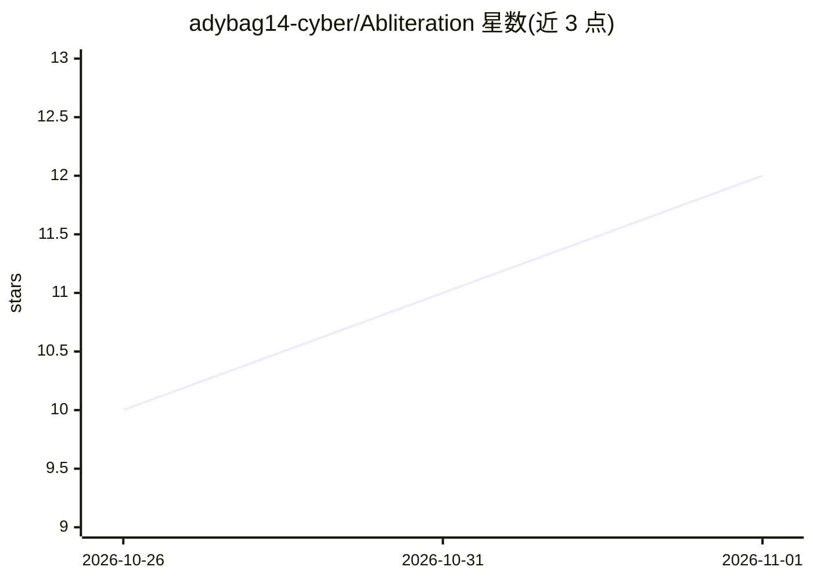

# adybag14-cyber/Abliteration

⭐ 12 · Python · Apache-2.0 · 推送 2026-10-31 · [GitHub](https://github.com/adybag14-cyber/Abliteration) · [官网](https://adybag14-cyber.github.io/Abliteration/) · 个人维护

**LLM abliteration（拒绝方向消除）方法手册与配套脚本合集**

面向研究人员的安全对齐手术主题知识手册：系统整理 2024–2026 年 abliteration 方法（Arditi、ORBA、COSMIC、SOM、SVD 等）、50+ 论文目录、课程路径与安装百科，覆盖 Qwen/Gemma/Llama 模型族、8GB 低显存路径、GGUF/Ollama 本地导入等场景。附 C++26 CLI（estimate/apply/hook/eval）与 Python 脚本、selective-checkpoint 选择性干预工具、一个实测 MiniCPM5-1B 例子（改动 4/219 个张量）及 JARVIS v7 工具修复数据包。以文档仓库形式提供，Apache-2.0 许可。

## 筛选速览

| 维度 | 判定 | 备注 |
|---|---|---|
| AI 角色 | `ai-knowledge` | 知识聚合/清单类 |
| 许可风险 | `permissive` | Apache-2.0 |
| 部署形态 | `library` | 以包/库形式分发 |
| 模型依赖 | — | README 未给出锁定关系 |
| 硬件要求 | — | 无带数字的原话,不猜 |
| 安装摩擦 | `low` | 无编译、无系统依赖或容器化 |
| 成熟度 | — | 结构信号不足 |

## 能力要点

- 覆盖方法、课程、安装矩阵与 50+ 论文目录的 abliteration 手册
- C++26 CLI（estimate/apply/hook/eval）与 Python 脚本、选择性张量干预工具
- 实测 MiniCPM5-1B 例子：改动 4/219 张量并以张量摘要验证其余权重不变
- 提供低显存（8GB GPU）、LoRA/QLoRA、thinking 模型等专题路径

## 适用场景

- 系统学习并复现 LLM 拒绝方向消除方法
- 对本地 Ollama/LM Studio 模型执行带回滚的 abliteration 流程
- 做选择性干预实验并做统计评估与溯源记录

## 场景标签

`教程课程` · 领域:学习与行业

## 证据(README 行号)

> L5: **Goal:** the most complete abliteration guide on the internet — every major **method**, **setup**, **bleeding-edge 
> L7: Living handbook for **LLM abliteration** (weight-level refusal-direction surgery) plus **agentic security** stacks f
> L46: **Abliteration** surgically removes refusal-related directions from transformer weights (Arditi et al., 2024). Resu

## 星数曲线

2026-10-26 10 → 2026-11-01 12（+2）

---
*卡片 v1 · prompt 1.4 · 生成 2026-11-01 · 置信度 mid · 依据 README sha `a3e2a13f3fb5` · [字段定义](../../DATASET.md)*
