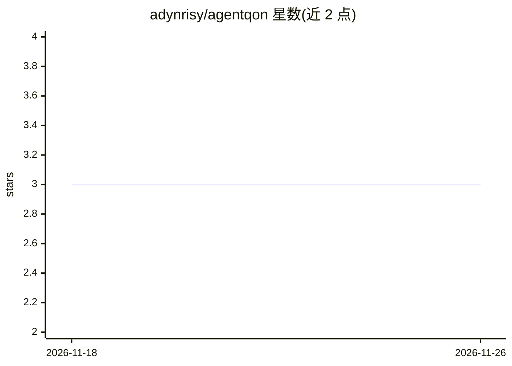

# adynrisy/agentqon

⭐ — · [GitHub]() · 个人维护

**本地 agent 平台：双 agent 使命运行、证据核验与 BYOK/本地模型接入**

AgentQon 通过一条 npm 命令安装终端 harness 与本地平台服务器（FastAPI + web UI，内置 6,799 agent 名册）。使命按 3 任务 DAG 由两个独立 agent 执行、critic 攻击其论断、确定性验证证据后给出两个候选并列比较。支持 BYOK 加密凭据库、OpenAI 兼容端点、OmniRoute 边车与本地 Ollama 自动检测，成本感知路由与预算预留；持久层支持 SQLite（零配置开发）与 PostgreSQL（生产，经环境变量切换），含持久队列与外部 worker 模式。未连接模型时生成类操作拒绝执行（HTTP 503）。

## 筛选速览

| 维度 | 判定 | 备注 |
|---|---|---|
| AI 角色 | `ai-ecosystem` | LLM/agent 周边工具 |
| 许可风险 | `permissive` | — |
| 部署形态 | `library` | 以包/库形式分发 |
| 模型依赖 | local-ok | 支持本地模型 |
| 硬件要求 | — | 无带数字的原话,不猜 |
| 安装摩擦 | `low` | 无编译、无系统依赖或容器化 |
| 成熟度 | — | 结构信号不足 |

## 能力要点

- 1 使命 → 3 任务 DAG → 2 独立 agent → critic 轮 → 双候选并列对比
- BYOK 加密凭据库、成本感知路由（6 种模式）与竞态安全的预算预留
- 本地 Ollama 零配置检测，无 key 时数据不出机器
- Skill Library（4,840 条 harvested skills）与 agentqon evolve 自演化报告

## 适用场景

- 让两个 agent 独立完成任务并用 critic 与证据核验对比产出
- 用本地 Ollama 模型在离线环境运行 agent 使命
- 按环境变量在 OpenRouter/Groq/OpenAI 等云提供商间切换并记账成本
- 通过持久队列与外部 worker 承载生产级使命运行

## 场景标签

`多智能体` `模型网关` · 领域:Agent 开发

## 证据(README 行号)

> L3: **A collaborative, evidence-driven agent platform** — built from *AI Agent Ecosystem: A Practical Engineering Textbo
> L149: 3. **Real AI agents** — OpenAI-compatible LLM adapters for the research and critic agents. The same code path runs
> L194: ## Connect a model — required for generation

## 星数曲线

2026-11-18 3 → 2026-11-26 3（+0）

---
*卡片 v1 · prompt 1.4 · 生成 2026-11-22 · 置信度 mid · 依据 README sha `df52ca1c6509` · [字段定义](../../DATASET.md)*
