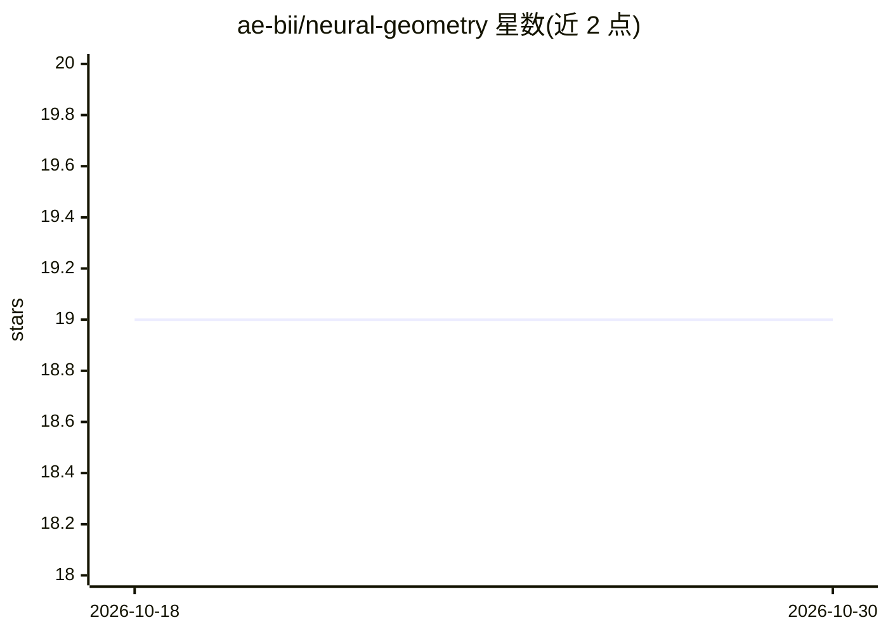

# ae-bii/neural-geometry

⭐ 19 · Python · MIT · 推送 2026-06-01 · [GitHub](https://github.com/ae-bii/neural-geometry) · [官网](https://ae-bii.github.io/neural-geometry/) · 组织维护

**探索神经网络潜空间几何性质的 Python 库**

Neural Geometry 是一个 Python 库，用于探索与操纵神经网络潜空间的几何性质：提供神经潜空间几何搜索框架实现（产品流形推断），并附带多种可选优化方法用于调整该框架的表现。库兼容 NumPy 与 PyTorch 等科学计算环境，面向在此类环境中工作的研究者与开发者。要求 Python 3.12 及以上，通过 uv/pip 安装，提供可选的开发与可视化扩展包。作者声明包处于早期阶段，更新可能引入破坏性变更。采用 MIT 许可证。

## 筛选速览

| 维度 | 判定 | 备注 |
|---|---|---|
| AI 角色 | `ai-native` | 本体是模型或模型工具 |
| 许可风险 | `permissive` | MIT |
| 部署形态 | `library` | 以包/库形式分发 |
| 模型依赖 | — | README 未给出锁定关系 |
| 硬件要求 | — | 无带数字的原话,不猜 |
| 安装摩擦 | `low` | 无编译、无系统依赖或容器化 |
| 成熟度 | `idea` | |

## 能力要点

- 神经潜空间几何搜索框架实现，用于产品流形推断
- 提供多种可选优化方法
- 兼容 NumPy 与 PyTorch

## 适用场景

- 研究神经网络潜空间的几何结构
- 机器学习与数据分析中做产品流形推断
- 在 PyTorch 工作流中集成潜空间几何分析

## 场景标签

`科研工具` · 领域:学习与行业

## 证据(README 行号)

> L6: Neural Geometry is a Python library designed to explore and manipulate the geometric properties of neural network la
> L10: - An implementation of the neural latent geometry search framework. This framework provides a unique approach to pr

## 星数曲线

2026-10-18 19 → 2026-10-30 19（+0）

---
*卡片 v1 · prompt 1.4 · 生成 2026-10-28 · 置信度 mid · 依据 README sha `3d631562c5bf` · [字段定义](../../DATASET.md)*
