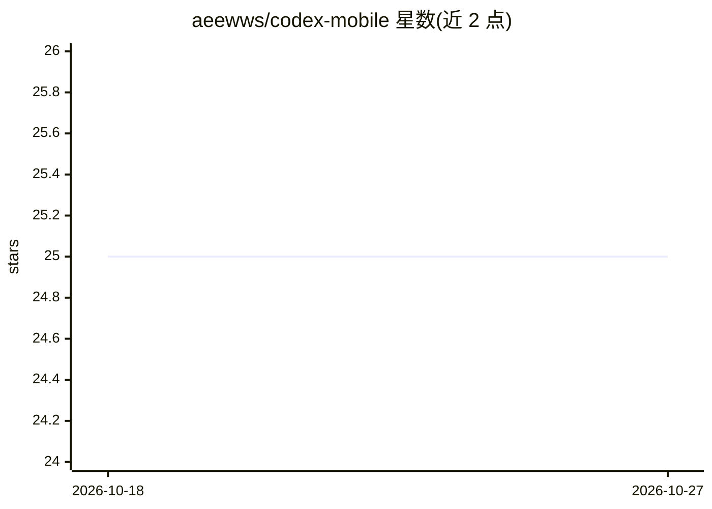

# aeewws/codex-mobile

⭐ 25 · Kotlin · MIT · 推送 2026-10-13 · [GitHub](https://github.com/aeewws/codex-mobile) · 个人维护 · 中文 README

**把 Termux 本地 Codex 运行时做成触摸优先的 Android 外壳**

基于 Jetpack Compose 的 Android 应用，围绕运行在 Termux 中的社区版 Codex CLI 后端提供移动端界面：自动拉起并连接本地后端、线程恢复与重连、历史会话管理、模型与权限模式切换、文档附件内容提取。通过本地 Socket 与 Termux 交互，依赖 root 做后端保活，默认面向 rooted Android 9+ 设备，需在 Termux 内完成本地登录。仓库公开 App 工程本身，两条 debug 构建渠道由 GitHub Actions 构建。

## 筛选速览

| 维度 | 判定 | 备注 |
|---|---|---|
| AI 角色 | `ai-ecosystem` | LLM/agent 周边工具 |
| 许可风险 | `permissive` | MIT |
| 部署形态 | `None` |  |
| 模型依赖 | — | README 未给出锁定关系 |
| 硬件要求 | — | 无带数字的原话,不猜 |
| 安装摩擦 | `low` | 无编译、无系统依赖或容器化 |
| 成熟度 | `idea` | |

## 能力要点

- 连接 Termux 内社区版 Codex CLI 的真实本地后端
- 后台恢复、重连与长会话线程续接
- 模型切换、权限模式与 Fast 模式等控制界面
- 基于 Jetpack Compose 的 Android App，Android CI 自动构建

## 适用场景

- 在 Android 手机上继续和使用本地 Codex 会话
- 以移动端界面管理模型、权限与历史会话
- 在 rooted 设备上长期保活本地 coding 后端

## 场景标签

`编码 Agent` · 领域:编码与开发

## 证据(README 行号)

> L8: Codex Mobile 是一个 Android 应用，目标是把运行在 Termux 里的真实本地 Codex 运行时，做成更像产品、而不是更像终端工具的手机体验。
> L29: - 接的是真实运行在 Termux 里的本地 Codex 后端，不是假聊天壳
> L39: - 后端运行在 Termux 里的社区版 Codex CLI

## 星数曲线

2026-10-18 25 → 2026-10-27 25（+0）

---
*卡片 v1 · prompt 1.4 · 生成 2026-10-27 · 置信度 high · 依据 README sha `309fb6225013` · [字段定义](../../DATASET.md)*
