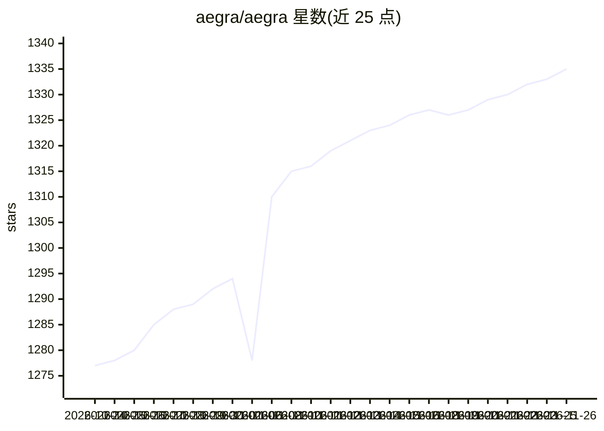

# aegra/aegra

⭐ 1,335 · Python · Apache-2.0 · 推送 2026-11-24 · [GitHub](https://github.com/aegra/aegra) · [官网](https://aegra.dev) · 组织维护

**自托管 AI agent 后端，替代 LangSmith Deployments**

基于 FastAPI 与 PostgreSQL 的自托管 agent 后端服务，兼容 LangGraph SDK 与 Agent Protocol，现有 LangGraph 代码无需修改即可接入。提供 worker 架构（Redis 任务队列、多实例水平扩展）、定时任务、webhook、人机协作审批门、SSE 流式输出、PostgreSQL 检查点持久化、pgvector 语义存储与 OpenTelemetry 追踪。鉴权支持 JWT/OAuth/Firebase。安装方式为 aegra-cli、源码加 docker compose。

## 筛选速览

| 维度 | 判定 | 备注 |
|---|---|---|
| AI 角色 | `ai-ecosystem` | LLM/agent 周边工具 |
| 许可风险 | `permissive` | Apache-2.0 |
| 部署形态 | `self-host` | docker 或自建部署 |
| 模型依赖 | — | README 未给出锁定关系 |
| 硬件要求 | — | 无带数字的原话,不猜 |
| 安装摩擦 | `low` | 无编译、无系统依赖或容器化 |
| 成熟度 | — | 结构信号不足 |

## 能力要点

- 兼容 LangGraph SDK 与 Agent Protocol v2 线程级 SSE 流式
- Redis 任务队列 worker 架构，每实例 30 并发 run 与租约式崩溃恢复
- 定时任务、webhook 回调与人机协作审批门
- pgvector 语义存储与 OpenTelemetry 追踪分发

## 适用场景

- 在自己的服务器上部署 LangGraph agent，无需使用 LangSmith 云
- 需要自定义 JWT/OAuth 鉴权与自有 Postgres 数据库的 agent 后端
- 为 agent 运行添加定时触发与 webhook 通知
- 将追踪数据分发到 Langfuse、Phoenix 等 OTLP 后端

## 场景标签

`Agent 框架` · 领域:Agent 开发

## 证据(README 行号)

> L18: Aegra is a drop-in replacement for LangSmith Deployments. Use the same LangGraph SDK, same APIs, but run it on your
> L79: - **Worker architecture** - Redis job queue with 30 concurrent runs per instance, lease-based crash recovery, and h
> L84: - **Persistent state** - PostgreSQL checkpoints via LangGraph

## 星数曲线

2026-10-24 1,277 → 2026-11-26 1,335（+58）

---
*卡片 v1 · prompt 1.4 · 生成 2026-11-23 · 置信度 high · 依据 README sha `5de731134157` · [字段定义](../../DATASET.md)*
