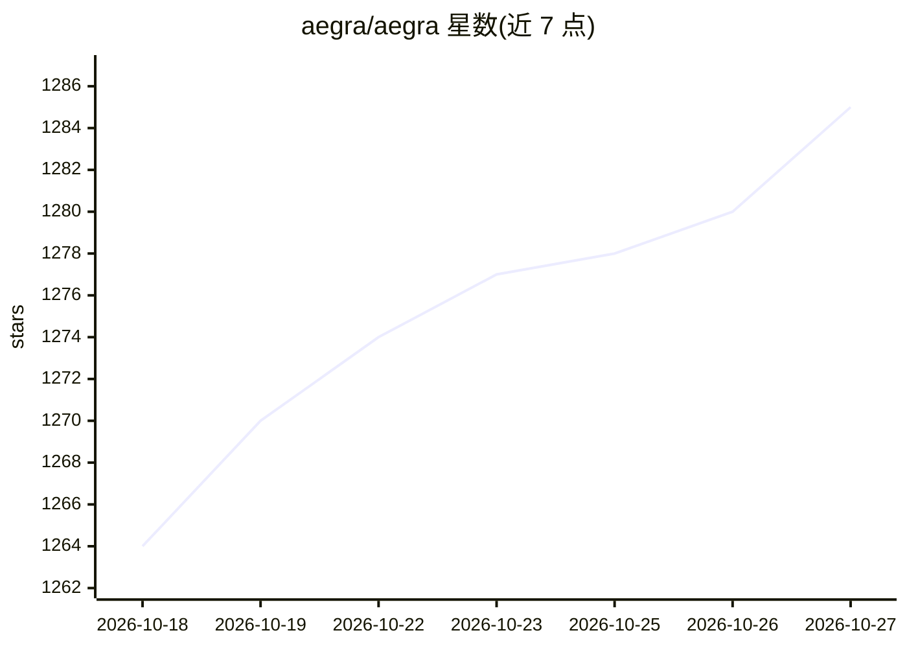

# aegra/aegra

⭐ 1,285 · Python · Apache-2.0 · 推送 2026-10-26 · [GitHub](https://github.com/aegra/aegra) · [官网](https://aegra.dev) · 组织维护

**LangSmith Deployments 的自托管开源替代：运行 LangGraph agent 后端**

基于 FastAPI、PostgreSQL 与 Redis 的自托管 AI agent 后端，作为 LangSmith Deployments 的 drop-in 替代：复用同一 LangGraph SDK 与 API，在自有基础设施上部署 agent。提供 Agent Protocol v2 流式（线程级 SSE、内容块事件、human-in-the-loop 恢复）、定时 cron 任务、可配置认证（JWT/OAuth/Firebase）、pgvector 语义存储、OTLP 可观测性。通过 aegra-cli（pip 安装）或源码 + Docker Compose 运行，要求 Python 3.12+。

## 筛选速览

| 维度 | 判定 | 备注 |
|---|---|---|
| AI 角色 | `ai-ecosystem` | LLM/agent 周边工具 |
| 许可风险 | `permissive` | Apache-2.0 |
| 部署形态 | `self-host` | docker 或自建部署 |
| 模型依赖 | — | README 未给出锁定关系 |
| 硬件要求 | — | 无带数字的原话,不猜 |
| 安装摩擦 | `low` | 无编译、无系统依赖或容器化 |
| 成熟度 | — | 结构信号不足 |

## 能力要点

- 复用 LangGraph SDK 与 API 的自托管部署后端
- Agent Protocol v2 线程级 SSE 流式与 human-in-the-loop
- Redis 任务队列（每实例 30 并发）与多实例横向扩展
- 内置定时 cron、可配置认证与 pgvector 语义存储

## 适用场景

- 把 LangGraph agent 从 LangChain 云端迁到自有基础设施部署
- 自托管运行 agent 并保持同一 LangGraph SDK 调用方式
- 需要数据驻留在本地的 agent 生产部署

## 场景标签

`Agent 框架` · 领域:Agent 开发

## 证据(README 行号)

> L18: Aegra is a drop-in replacement for LangSmith Deployments. Use the same LangGraph SDK, same APIs, but run it on your
> L5:  Self-hosted LangSmith Deployments alternative. Your infrastructure, your rules.

## 星数曲线

2026-10-18 1,264 → 2026-10-27 1,285（+21）

---
*卡片 v1 · prompt 1.4 · 生成 2026-10-21 · 置信度 high · 依据 README sha `7d521a193e97` · [字段定义](../../DATASET.md)*
