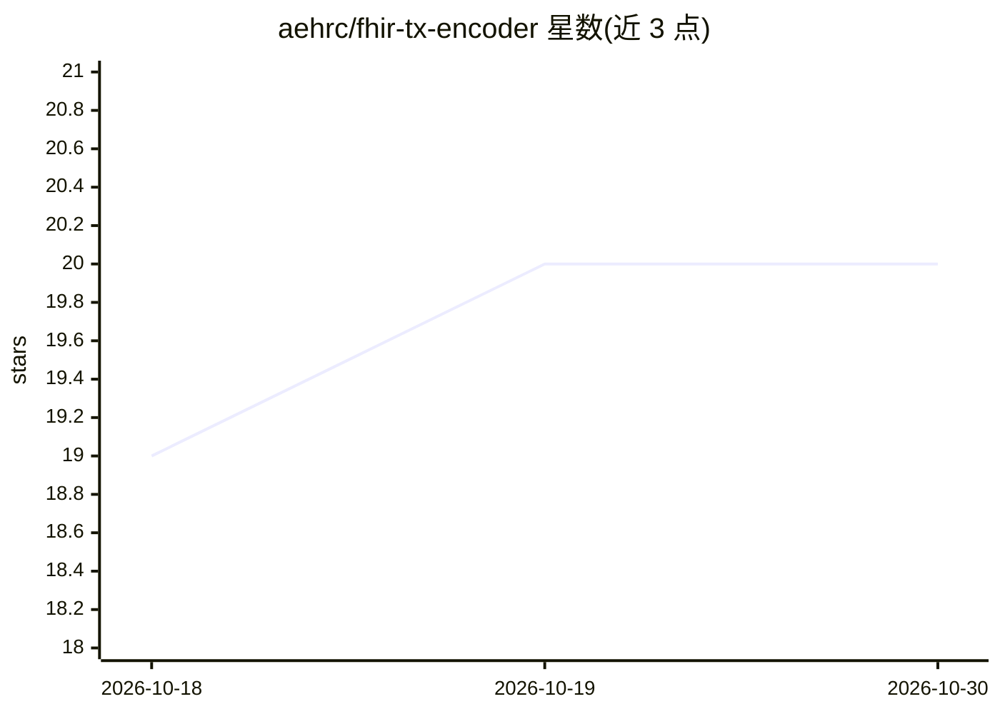

# aehrc/fhir-tx-encoder

⭐ 20 · R · Apache-2.0 · 推送 2026-09-21 · [GitHub](https://github.com/aehrc/fhir-tx-encoder) · 组织维护

**将 FHIR 术语编码为机器学习特征的编码器（Python/R）**

给定 FHIR ValueSet URI 与术语服务端点，编码器扩展范围、检索概念间的上下位（subsumption）关系，输出 multi-hot 稀疏矩阵；每个编码为自身及所有上位概念各携带一个特征，使本体上相近的编码共享特征，概念属性可作附加特征。以 Python（PyPI 包 fhir-tx-encoder）与 R（GitHub 包 fhirtxencoder）双实现提供，Python 版实现 scikit-learn transformer 接口、可用于 Pipeline。README 声明处于 alpha 阶段，尚不适用于生产环境。

## 筛选速览

| 维度 | 判定 | 备注 |
|---|---|---|
| AI 角色 | `ai-ecosystem` | LLM/agent 周边工具 |
| 许可风险 | `permissive` | Apache-2.0 |
| 部署形态 | `library` | 以包/库形式分发 |
| 模型依赖 | — | README 未给出锁定关系 |
| 硬件要求 | — | 无带数字的原话,不猜 |
| 安装摩擦 | `low` | 无编译、无系统依赖或容器化 |
| 成熟度 | `idea` | |

## 能力要点

- 基于 FHIR 术语服务扩展 ValueSet 并检索 subsumption 关系
- 输出 multi-hot 稀疏矩阵，本体相近编码共享特征
- Python 实现兼容 scikit-learn transformer 接口、可入 Pipeline
- 同一思路的 Python 与 R 双语言实现

## 适用场景

- 把临床术语编码转为机器学习模型的输入特征
- 在 scikit-learn 流水线中预处理 FHIR 术语编码
- 在 R 环境中对 FHIR 概念做特征编码

## 场景标签

 · 领域:医疗信息学/机器学习

## 证据(README 行号)

> L3: Encoders that use a FHIR terminology server to turn
> L4: terminology codes into features for machine learning.
> L8: relationships between the concepts within it, and returns a multi-hot encoded

## 星数曲线

2026-10-18 19 → 2026-10-30 20（+1）

---
*卡片 v1 · prompt 1.4 · 生成 2026-10-28 · 置信度 high · 依据 README sha `069e30ceb45a` · [字段定义](../../DATASET.md)*
