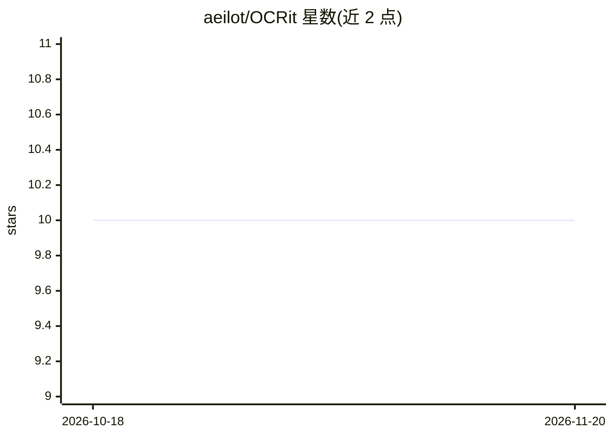

# aeilot/OCRit

⭐ 10 · Swift · MIT · 推送 2025-11-24 · [GitHub](https://github.com/aeilot/OCRit) · 个人维护

**macOS 小工具：用 DeepSeek-OCR 识别图片文字为可复制文本**

Swift 编写的 macOS 原生工具，通过 DeepSeek-OCR 集成对拖入的照片运行 OCR，将文字内容识别为支持 LaTeX 的 Markdown，并支持复制到剪贴板供后续处理。模型推理通过 Silicon Flow 提供的 API 完成。安装方式为 release 页下载二进制，也可用 Xcode 从源码构建（需 macOS 26+）。

## 筛选速览

| 维度 | 判定 | 备注 |
|---|---|---|
| AI 角色 | `ai-native` | 本体是模型或模型工具 |
| 许可风险 | `permissive` | MIT |
| 部署形态 | `desktop` | 安装包/桌面程序 |
| 模型依赖 | locked-api |  |
| 硬件要求 | — | 无带数字的原话,不猜 |
| 安装摩擦 | `low` | 无编译、无系统依赖或容器化 |
| 成熟度 | — | 结构信号不足 |

## 能力要点

- 拖入照片即可运行 OCR
- 识别结果为 Markdown 且支持 LaTeX
- 识别文本一键复制到剪贴板
- Swift 编写的 macOS 原生界面

## 适用场景

- 把截图或照片中的文字提取出来复制使用
- 识别含公式的内容为 LaTeX Markdown
- 轻量级本地图片文字识别工具

## 场景标签

`OCR` · 领域:感知与多模态

## 证据(README 行号)

> L5: OCRit is a small macOS utility written in Swift that uses DeepSeek-OCR to recognize text from photos and make it ava
> L11: - Fast OCR using DeepSeek-OCR integration

## 星数曲线

2026-10-18 10 → 2026-11-20 10（+0）

---
*卡片 v1 · prompt 1.4 · 生成 2026-11-20 · 置信度 high · 依据 README sha `8a32faa542b0` · [字段定义](../../DATASET.md)*
