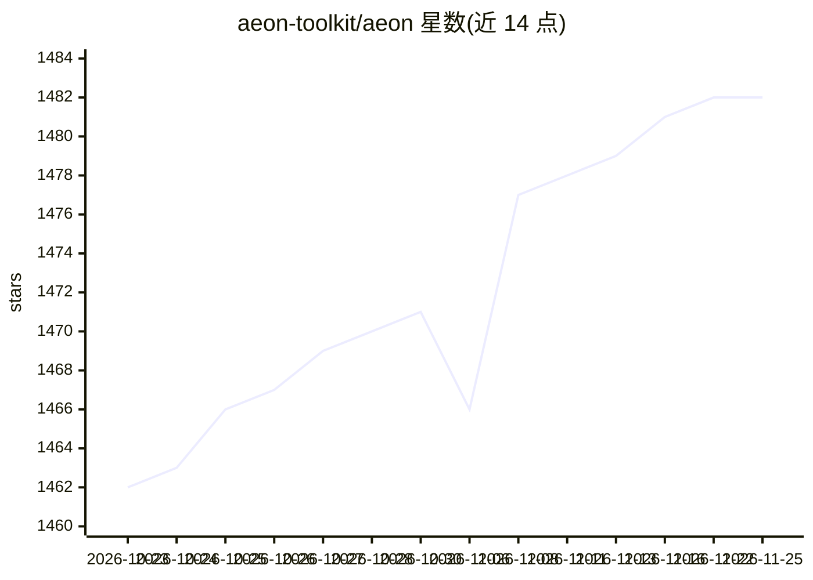

# aeon-toolkit/aeon

⭐ 1,482 · Python · BSD-3-Clause · 推送 2026-11-23 · [GitHub](https://github.com/aeon-toolkit/aeon) · [官网](https://aeon-toolkit.org/) · 组织维护

**面向研究者与开发者的时间序列机器学习 Python 工具库**

aeon 是兼容 scikit-learn API 的时间序列机器学习库，覆盖分类、回归、聚类、预测、异常检测、分割、相似性搜索、距离度量、变换与基准测试十个任务领域。许多算法由原始方法作者贡献与维护，与时间序列研究社区保持紧密合作，并运行领域内基准评测。安装要求 Python 3.10+，核心通过 pip 安装，深度学习依赖通过可选扩展安装；部分模块仍处于开发状态，弃用策略不完全适用。

## 筛选速览

| 维度 | 判定 | 备注 |
|---|---|---|
| AI 角色 | `ai-native` | 本体是模型或模型工具 |
| 许可风险 | `permissive` | BSD-3-Clause |
| 部署形态 | `library` | 以包/库形式分发 |
| 模型依赖 | — | README 未给出锁定关系 |
| 硬件要求 | — | 无带数字的原话,不猜 |
| 安装摩擦 | `low` | 无编译、无系统依赖或容器化 |
| 成熟度 | — | 结构信号不足 |

## 能力要点

- 十个时间序列任务领域共享一致的 scikit-learn 兼容 API
- 提供 InceptionTime、HIVE-COTEv2.0、SETAR-Tree、KASBA 等算法实现
- networks 模块提供基于 Keras/TensorFlow 的深度学习架构
- 提供可复现的基准测试工具

## 适用场景

- 对时间序列数据做分类或回归预测
- 训练模型预测未来数值（时间序列预测）
- 检测时间序列中的异常点或异常子序列
- 以统一 API 复现和比较时间序列算法的实验结果

## 场景标签

`模型评测` · 领域:评测与运维

## 证据(README 行号)

> L7: `aeon` is a scikit-learn compatible Python library for learning from time series.
> L8: It covers classification, regression, clustering, forecasting, anomaly detection,
> L126: |**Benchmarking**|Reproducible experimental evaluation|docs →|

## 星数曲线

2026-10-23 1,462 → 2026-11-25 1,482（+20）

---
*卡片 v1 · prompt 1.4 · 生成 2026-11-23 · 置信度 high · 依据 README sha `7e5efc7da0e6` · [字段定义](../../DATASET.md)*
