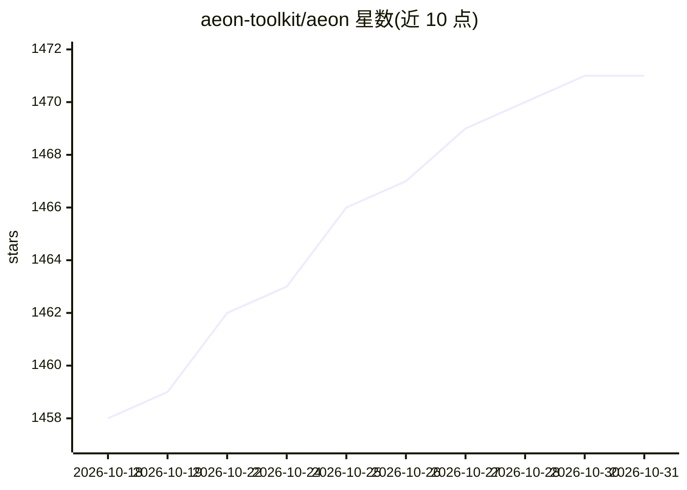

# aeon-toolkit/aeon

⭐ 1,471 · Python · BSD-3-Clause · 推送 2026-10-30 · [GitHub](https://github.com/aeon-toolkit/aeon) · [官网](https://aeon-toolkit.org/) · 组织维护

**面向时间序列机器学习的 scikit-learn 兼容 Python 工具库**

aeon 是用于时间序列学习的 Python 库，提供分类、回归、聚类、预测、异常检测、分割、相似性搜索、变换、距离与基准评测共十个任务领域，API 与 scikit-learn 兼容。许多算法由原论文作者贡献和维护，含 Keras/TensorFlow 深度学习架构（InceptionTime、Rocket 系列等）。2022 年从 sktime v0.16.0 分叉而来，由 13 人核心团队开发，获 NumFOCUS 支持，2024 年发表于 JMLR。要求 Python 3.10+，anomaly_detection、forecasting、segmentation 等模块仍在开发中，不适用弃用策略。

## 筛选速览

| 维度 | 判定 | 备注 |
|---|---|---|
| AI 角色 | `ai-native` | 本体是模型或模型工具 |
| 许可风险 | `permissive` | BSD-3-Clause |
| 部署形态 | `library` | 以包/库形式分发 |
| 模型依赖 | — | README 未给出锁定关系 |
| 硬件要求 | — | 无带数字的原话,不猜 |
| 安装摩擦 | `low` | 无编译、无系统依赖或容器化 |
| 成熟度 | `idea` | |

## 能力要点

- 覆盖十大时间序列任务领域的统一 API
- 众多算法由原始论文作者贡献维护
- Keras/TensorFlow 深度学习架构（InceptionTime、HIVE-COTEv2.0 等）
- 内置可复现基准评测模块

## 适用场景

- 对时间序列数据做分类、聚类或预测建模
- 时间序列异常检测与分割分析
- 复现或对比时间序列研究中的新方法
- 学术研究中的可引用工具（JMLR 2024）

## 场景标签

 · 领域:时间序列机器学习/数据科学

## 证据(README 行号)

> L7: `aeon` is a scikit-learn compatible Python library for learning from time series.
> L8: It covers classification, regression, clustering, forecasting, anomaly detection,
> L117: |**Classification**|Predict labels for time series|docs →|

## 星数曲线

2026-10-18 1,458 → 2026-10-31 1,471（+13）

---
*卡片 v1 · prompt 1.4 · 生成 2026-10-21 · 置信度 high · 依据 README sha `f84269977b77` · [字段定义](../../DATASET.md)*
