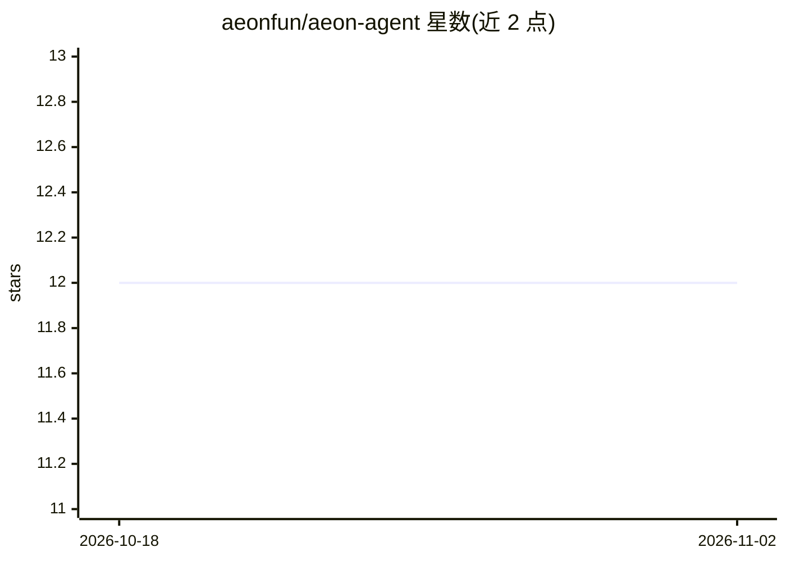

# aeonfun/aeon-agent

⭐ 12 · JavaScript · MIT · 推送 2026-11-01 · [GitHub](https://github.com/aeonfun/aeon-agent) · [官网](https://t.me/aeon_agent) · 个人维护

**在 GitHub Actions 上定时无人值守运行的自主 agent 框架实例**

aeonfun/aeon-agent 是 Aeon 框架的公开运行实例（growth agent），驱动 aeonfun/aeon 仓库与 $AEON；框架本体在 aeonfun/aeon。它以单个 SKILL.md 文件（frontmatter+提示词）定义技能，共 91 个技能、6 个技能包，经统一 run-harness 契约在 Claude、Grok、Codex、Pi、Vibe、Kimi 六种 agent CLI 上执行，由 GitHub Actions cron 调度，无人值守地提交 PR、部署应用到 Vercel、私下披露漏洞、生成新技能，并含自我健康检查与修复循环。配置集中在 aeon.yml。可用浏览器（aeon.fun/connect）、编码 agent 或终端（Node.js 20+ 与 gh CLI）从框架仓库创建自己的实例。

## 筛选速览

| 维度 | 判定 | 备注 |
|---|---|---|
| AI 角色 | `ai-ecosystem` | LLM/agent 周边工具 |
| 许可风险 | `permissive` | MIT |
| 部署形态 | `None` |  |
| 模型依赖 | locked-api |  |
| 硬件要求 | — | 无带数字的原话,不猜 |
| 安装摩擦 | `low` | 无编译、无系统依赖或容器化 |
| 成熟度 | — | 结构信号不足 |

## 能力要点

- 91 个技能、6 个技能包，技能以单个 SKILL.md 文件定义
- 统一 run-harness 契约支持 Claude/Grok/Codex/Pi/Vibe/Kimi 六种 agent CLI
- GitHub Actions cron 无人值守运行：提交 PR、部署、漏洞披露、自写技能
- heartbeat→skill-health→skill-repair→self-improve 的自修复循环与 fleet 分叉机制

## 适用场景

- 定时无人值守地为仓库提交功能代码与 PR
- 自动扫描并私下披露开源仓库的真实漏洞
- 从一句话生成新技能并自我修复失效技能

## 场景标签

`编码 Agent` `网络安全` · 领域:编码与开发

## 证据(README 行号)

> L13: > **This is a live Aeon instance**: the growth agent for the Aeon framework, running the aeonfun/aeon repo and $AEO
> L65:  Six engines, one socket - a SKILL.md flows through run-harness into any of six agent CLIs: Claude, Grok, Codex, Pi

## 星数曲线

2026-10-18 12 → 2026-11-02 12（+0）

---
*卡片 v1 · prompt 1.4 · 生成 2026-11-01 · 置信度 high · 依据 README sha `417edf821588` · [字段定义](../../DATASET.md)*
