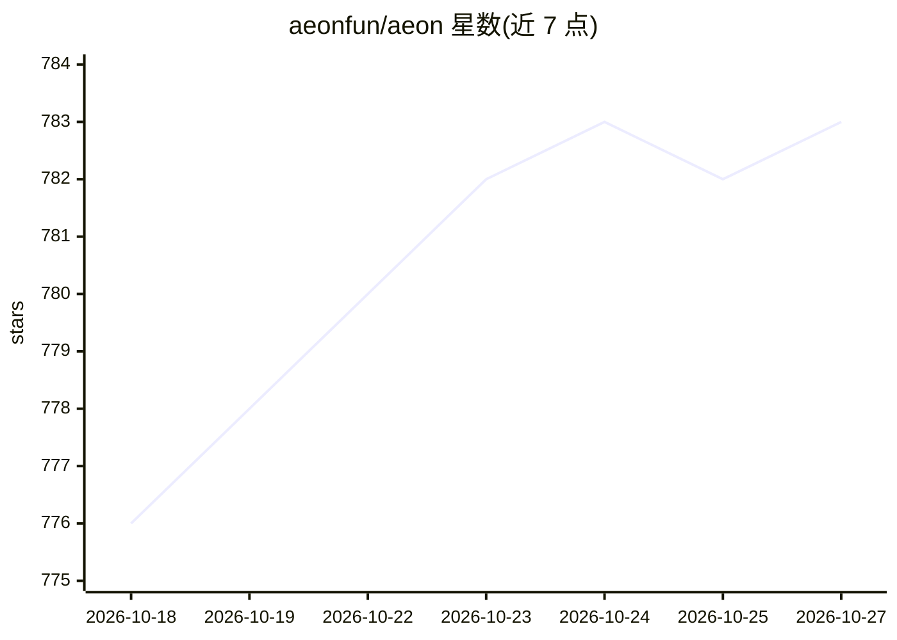

# aeonfun/aeon

⭐ 783 · JavaScript · MIT · 推送 2026-10-26 · [GitHub](https://github.com/aeonfun/aeon) · [官网](https://www.aeon.fun/) · 组织维护

**在 GitHub Actions 上无人值守运行的多 harness 自主 agent 框架**

面向开发者的自主 agent 框架：以单个 SKILL.md 文件（frontmatter+提示词）定义技能，通过统一 run-harness 契约驱动九种 agent CLI（Claude Code、Grok、Codex、Pi、Vibe、Kimi、fx、Cursor、Hermes），在用户自己的 GitHub Actions 上按 cron 定时无人值守运行，可提交 PR、部署应用到 Vercel、私下披露漏洞、生成新技能。内含自我修复循环（运行评分 1-5、检测并修复损坏技能）与实例分裂成舰队的机制；默认带只读保护、不可逆操作失败关闭等护栏。配置集中在一个 aeon.yml。支持浏览器端 Aeon Connect 一键创建或终端 ./aeon init 初始化（需 Node.js 20+ 与 GitHub CLI）。

## 筛选速览

| 维度 | 判定 | 备注 |
|---|---|---|
| AI 角色 | `ai-ecosystem` | LLM/agent 周边工具 |
| 许可风险 | `permissive` | MIT |
| 部署形态 | `None` |  |
| 模型依赖 | locked-api |  |
| 硬件要求 | — | 无带数字的原话,不猜 |
| 安装摩擦 | `low` | 无编译、无系统依赖或容器化 |
| 成熟度 | — | 结构信号不足 |

## 能力要点

- 86 个技能、6 个技能包，技能以单个 SKILL.md 文件定义
- 一套 run-harness 契约驱动九种 agent CLI（Claude Code/Grok/Codex/Kimi/Cursor 等）
- 运行评分与 skill-repair/self-improve 自我修复循环
- spawn-instance 可分裂为多个专项实例，密钥隔离、计费独立

## 适用场景

- 定时让 agent 无人值守向仓库提交 PR、部署原型应用
- 自动扫描并私下披露开源仓库漏洞
- 从一句话生成新技能并纳入日程
- 从 ChatGPT/Claude/Cursor 对话中通过 MCP 连接器操控自己的 agent 实例

## 场景标签

`Agent 框架` `编码 Agent` `网络安全` · 领域:Agent 开发

## 证据(README 行号)

> L91:  Nine engines, one socket - a SKILL.md flows through run-harness into any of nine agent CLIs: Claude, Grok, Codex, 
> L42: git clone https://github.com/aeonfun/aeon && cd aeon
> L29:  Quick start in four steps: Sign in, Connect, Pick, Run. 1 Sign in - log in with GitHub at www.aeon.fun/connect and

## 星数曲线

2026-10-18 776 → 2026-10-27 783（+7）

---
*卡片 v1 · prompt 1.4 · 生成 2026-10-21 · 置信度 high · 依据 README sha `845a2d81a55c` · [字段定义](../../DATASET.md)*
