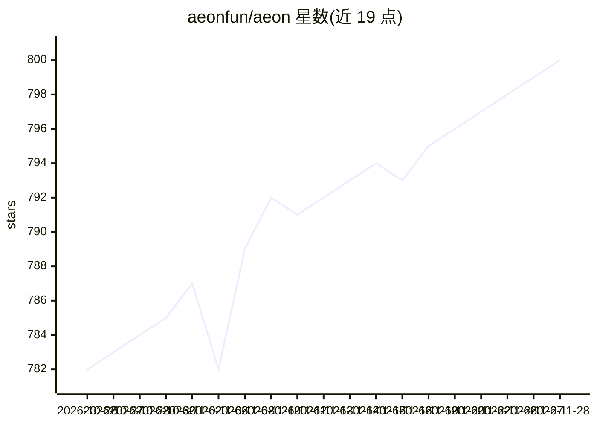

# aeonfun/aeon

⭐ 800 · JavaScript · MIT · 推送 2026-11-27 · [GitHub](https://github.com/aeonfun/aeon) · [官网](https://www.aeon.fun) · 个人维护

**让个人在 GitHub Actions 上 24/7 无人值守运行 agent 技能群的框架**

Aeon 是一个把 agent 技能（SKILL.md 文件）调度到 GitHub Actions 上定时、无人值守运行的框架：技能即 Markdown 文件（frontmatter + 提示词），内置 6 个技能包共 93 个技能，覆盖代码提交、部署、漏洞披露、自写技能等。同一 SKILL.md 通过 run-harness 契约可在 10 种 agent CLI 上运行；自愈循环（heartbeat→skill-health→skill-repair）检测并修复失效技能，spawn-instance 可复制出专属实例集群。运行发生在用户自己的 GitHub Actions 与加密 secrets 中，项目本身不设服务器（托管 MCP 为可选）。

## 筛选速览

| 维度 | 判定 | 备注 |
|---|---|---|
| AI 角色 | `ai-ecosystem` | LLM/agent 周边工具 |
| 许可风险 | `permissive` | MIT |
| 部署形态 | `None` |  |
| 模型依赖 | locked-api |  |
| 硬件要求 | — | 无带数字的原话,不猜 |
| 安装摩擦 | `low` | 无编译、无系统依赖或容器化 |
| 成熟度 | — | 结构信号不足 |

## 能力要点

- 技能即单个 SKILL.md 文件，6 个技能包共 93 个技能
- 同一 SKILL.md 经 run-harness 契约运行于 10 种 agent CLI（Claude/Grok/Codex 等）
- 自愈循环检测、评分并修复失效技能；可复制出隔离计费的实例集群
- 运行在用户自己的 GitHub Actions 上，密钥存于仓库加密 secrets

## 适用场景

- 定时无人值守地给仓库提 PR、部署原型到 Vercel
- 扫描开源仓库漏洞并私下披露
- 让 agent 集群 24/7 跟踪加密行情或社媒提及

## 场景标签

`Agent 框架` `提示工程` `编码 Agent` · 领域:Agent 开发

## 证据(README 行号)

> L84:  Six skill packs, 93 skills total: Core (fleet coordination, self-config, liveness), Evolution (authors and heals i
> L94:  Ten engines, one socket - a SKILL.md flows through run-harness into any of ten agent CLIs: Claude, Grok, Codex, Pi

## 星数曲线

2026-10-26 782 → 2026-11-28 800（+18）

---
*卡片 v1 · prompt 1.4 · 生成 2026-11-28 · 置信度 high · 依据 README sha `2fe41b2d254c` · [字段定义](../../DATASET.md)*
