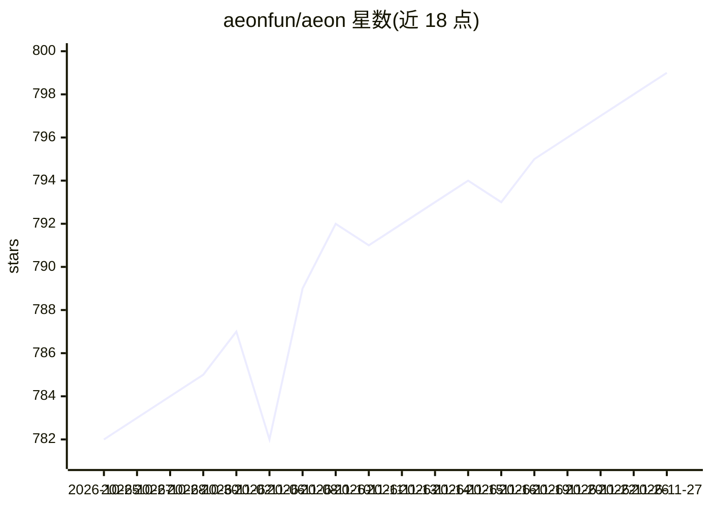

# aeonfun/aeon

⭐ 799 · JavaScript · MIT · 推送 2026-11-26 · [GitHub](https://github.com/aeonfun/aeon) · [官网](https://www.aeon.fun/) · 个人维护

**在 GitHub Actions 无人值守运行的自治 agent 框架**

Aeon 是一个自治 agent 框架：技能以单个 SKILL.md 文件（frontmatter + 提示词）定义，通过统一 run-harness 契约分发到十个 agent CLI 运行，任务调度在用户自己的 GitHub Actions 上执行。共六个技能包 93 个技能，覆盖代码提交（PR）、应用部署（Vercel）、漏洞私下披露、研究与自我编写技能；内置心跳循环对运行评分 1-5 并修复失效技能，支持 fork 出多个专职实例组成 fleet。默认含只读限制、不可逆操作失败关闭等护栏。安装需 Node.js 20+ 与 GitHub CLI。

## 筛选速览

| 维度 | 判定 | 备注 |
|---|---|---|
| AI 角色 | `ai-ecosystem` | LLM/agent 周边工具 |
| 许可风险 | `permissive` | MIT |
| 部署形态 | `None` |  |
| 模型依赖 | locked-api |  |
| 硬件要求 | — | 无带数字的原话,不猜 |
| 安装摩擦 | `low` | 无编译、无系统依赖或容器化 |
| 成熟度 | — | 结构信号不足 |

## 能力要点

- 93 个技能（SKILL.md 格式）分属六个技能包
- 同一 SKILL.md 经 run-harness 契约运行于十个 agent CLI
- 运行发生在用户自己的 GitHub Actions，密钥存于仓库加密 secrets
- 自我修复循环：运行评分 1-5 并自动修复失效技能

## 适用场景

- 定时无人值守地向仓库提交 PR 与部署原型应用
- 对开源仓库做漏洞扫描并私下披露
- 用 cron 安排每日聚合、研究、内容类任务
- 让框架 fork 出多个专职实例并集中管理

## 场景标签

`Agent 框架` `编码 Agent` · 领域:Agent 开发

## 证据(README 行号)

> L1: AEON - the most autonomous agent framework. 93 skills across 10 harnesses (Claude Code, Grok, Codex, Pi, Vibe, Kimi,
> L95:  Nine engines, one socket - a SKILL.md flows through run-harness into any of ten agent CLIs: Claude, Grok, Codex, P

## 星数曲线

2026-10-25 782 → 2026-11-27 799（+17）

---
*卡片 v1 · prompt 1.4 · 生成 2026-11-27 · 置信度 high · 依据 README sha `ca03307a0dea` · [字段定义](../../DATASET.md)*
