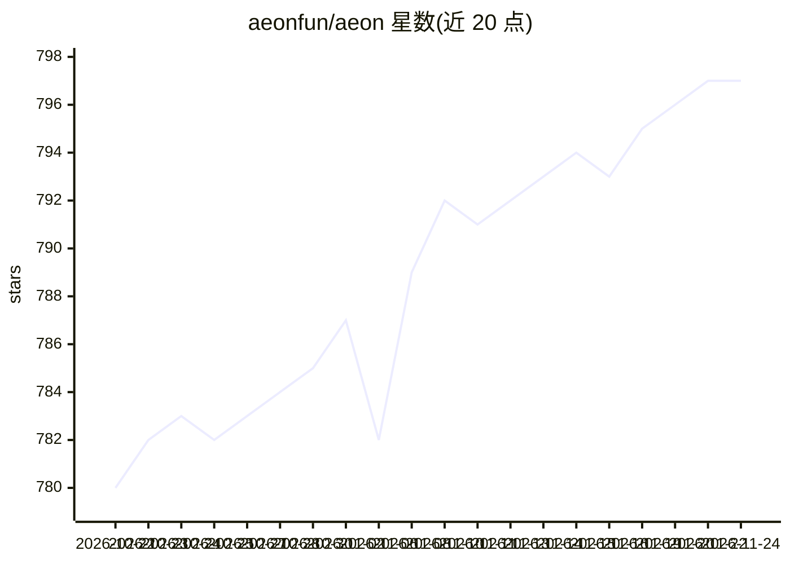

# aeonfun/aeon

⭐ 797 · JavaScript · MIT · 推送 2026-11-21 · [GitHub](https://github.com/aeonfun/aeon) · [官网](https://www.aeon.fun/) · 组织维护

**在 GitHub Actions 无人值守运行的自主 agent 框架**

Aeon 是一个 agent 框架，将 SKILL.md 格式的技能（共 93 个、6 个技能包）调度到 GitHub Actions 上按 cron 无人值守运行，覆盖提交代码 PR、部署应用到 Vercel、漏洞扫描与私下披露、自我撰写与修复技能（heartbeat→skill-health→skill-repair→self-improve 循环）等。同一技能文件通过 run-harness 契约可在 9 个 agent CLI 上运行。运行发生在用户自己的仓库与 Actions 上，密钥存于仓库加密 secrets。安装需 Node.js 20+ 与 GitHub CLI，或通过浏览器版 Aeon Connect 免安装使用。

## 筛选速览

| 维度 | 判定 | 备注 |
|---|---|---|
| AI 角色 | `ai-ecosystem` | LLM/agent 周边工具 |
| 许可风险 | `permissive` | MIT |
| 部署形态 | `None` |  |
| 模型依赖 | locked-api |  |
| 硬件要求 | — | 无带数字的原话,不猜 |
| 安装摩擦 | `low` | 无编译、无系统依赖或容器化 |
| 成熟度 | — | 结构信号不足 |

## 能力要点

- 93 个 SKILL.md 技能分 6 个技能包，按 cron 调度无人值守运行
- run-harness 契约使同一技能在 9 个 agent CLI 上互换运行
- 自愈循环：运行评分 1-5，检测并修复失效技能
- spawn-instance 可派生专业化实例组成 fleet

## 适用场景

- 让 agent 定时向我的仓库提交功能 PR
- 定期做漏洞扫描并私下披露
- 安排每日信息聚合与研究任务自动运行

## 场景标签

`Agent 框架` · 领域:Agent 开发

## 证据(README 行号)

> L1: AEON - the most autonomous agent framework. 93 skills across 9 harnesses (Claude Code, Grok, Codex, Pi, Vibe, Kimi, 
> L93:  Nine engines, one socket - a SKILL.md flows through run-harness into any of nine agent CLIs: Claude, Grok, Codex, 
> L29:  Quick start in four steps: Sign in, Connect, Pick, Run. 1 Sign in - log in with GitHub at www.aeon.fun/connect and

## 星数曲线

2026-10-22 780 → 2026-11-24 797（+17）

---
*卡片 v1 · prompt 1.4 · 生成 2026-11-24 · 置信度 high · 依据 README sha `2b87d849973b` · [字段定义](../../DATASET.md)*
