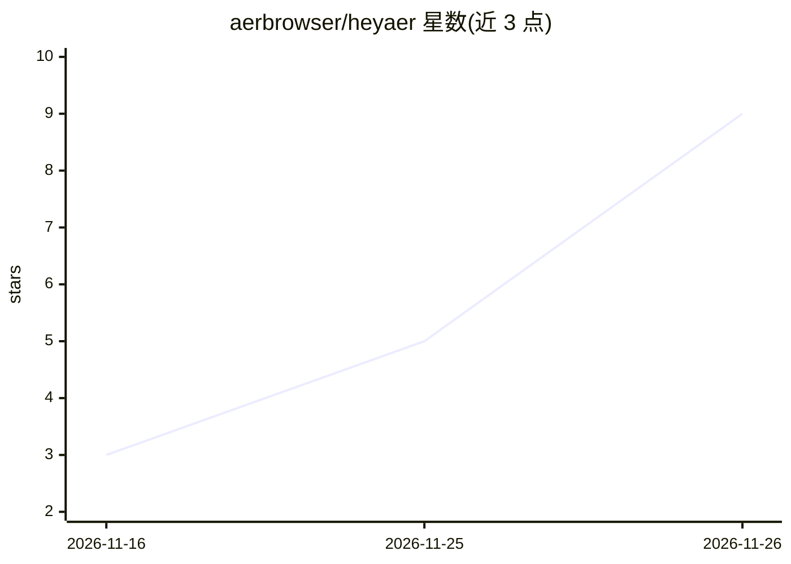

# aerbrowser/heyaer

⭐ 9 · Shell · 推送 2026-11-25 · [GitHub](https://github.com/aerbrowser/heyaer) · [官网](https://heyaer.com) · 个人维护

**面向工作区场景的 macOS Chromium 浏览器，内置 AI 助手与 Bot**

基于 Chromium 为 macOS（Apple Silicon）独立构建的浏览器，提供 Spaces 工作区、垂直标签、分屏、浏览器数据导入（Arc/Chrome/Safari）与 Chrome 扩展安装。AI 部分：右侧面板引用最多 8 个标签页做摘要、翻译、提取、起草等命令，可自配模型服务 URL、模型 ID 与 API key；Bot 库含 24 个模板，支持目标、资源范围、记忆与定时（定时需 Pro）；另有 20 个应用连接器与本地导出命令（Markdown/PNG/微信文章）。仓库提供官方 DMG 下载与更新，浏览器源码另行维护。

## 筛选速览

| 维度 | 判定 | 备注 |
|---|---|---|
| AI 角色 | `ai-enhanced` | 去掉 AI 部分产品仍成立 |
| 许可风险 | `none` | — |
| 部署形态 | `desktop` | 安装包/桌面程序 |
| 模型依赖 | — | README 未给出锁定关系 |
| 硬件要求 | — | 无带数字的原话,不猜 |
| 安装摩擦 | `low` | 无编译、无系统依赖或容器化 |
| 成熟度 | `idea` | |

## 能力要点

- AI 面板引用最多 8 个打开的标签页进行总结、翻译、提取与起草
- 自配模型服务连接（URL、模型 ID、API key），BYOK 模式
- 24 个 Bot 模板，支持目标、记忆、资源范围与定时调度
- 20 个应用连接器（Notion、GitHub、Gmail、Slack 等）

## 适用场景

- 按项目把研究资料整理进不同 Space 并边读边问 AI
- 用 Bot 定时执行收件箱摘要、竞品监测等重复性工作
- 把 Arc 或 Chrome 的数据迁移到新浏览器
- 导出网页为 Markdown 或长截图存入个人库

## 场景标签

`AI 助手` · 领域:对话与助手

## 证据(README 行号)

> L4:  Aer — A Browser Built Around Your Workspace and AI.
> L16: Your browser is where research starts, ideas take shape, and work gets done. Aer brings those activities together: 
> L30: **Requires an Apple Silicon Mac running macOS 13 or later.** The current release does not include Intel Mac, Window

## 星数曲线

2026-11-16 3 → 2026-11-26 9（+6）

---
*卡片 v1 · prompt 1.4 · 生成 2026-11-22 · 置信度 high · 依据 README sha `ccd9b73bbad5` · [字段定义](../../DATASET.md)*
