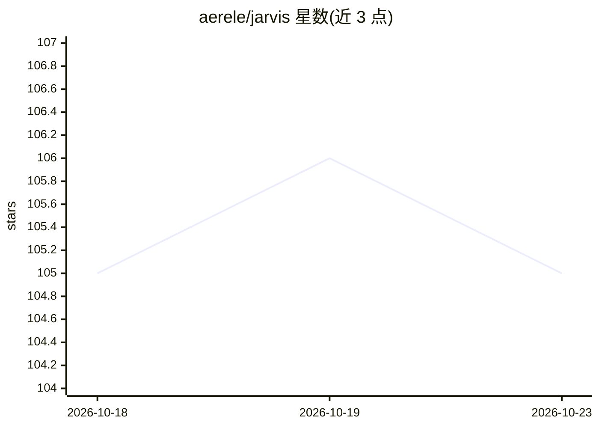

# aerele/jarvis

⭐ 105 · Python · AGPL-3.0 · 推送 2026-10-22 · [GitHub](https://github.com/aerele/jarvis) · [官网](jarvis.aerele.in) · 组织维护

**嵌入 ERPNext 的 AI 队友：用自然语言问询与审核业务**

Frappe/ERPNext 应用（app），在企业 ERP 内提供对话式问询、单据审阅与流程自动化：以用户自身权限读写记录，写操作须经 Approval Board 人工批准；File Box 读取供应商账单等文件生成待审草稿；支持 Business Notes、Skill、Macro、Trigger、后台 Agent、Dashboard 与移动端。管理员可接入既有聊天订阅或 API key 并配置可用模型。AP Invoice 审查模块限定为草稿 Purchase Invoice 的文档匹配审阅，不提交过账，税务合规未实现。

## 筛选速览

| 维度 | 判定 | 备注 |
|---|---|---|
| AI 角色 | `ai-native` | 本体是模型或模型工具 |
| 许可风险 | `viral` | AGPL-3.0 |
| 部署形态 | `None` |  |
| 模型依赖 | — | README 未给出锁定关系 |
| 硬件要求 | — | 无带数字的原话,不猜 |
| 安装摩擦 | `low` | 无编译、无系统依赖或容器化 |
| 成熟度 | — | 结构信号不足 |

## 能力要点

- 所有问答与操作在用户自身 Frappe/ERPNext 权限下运行，数据不离开服务器
- 写/提交类操作须经 Approval Board 人工审核
- File Box 文档读取+审批看板把单据转为已审工作
- Skill/Macro/Trigger/Agent 把业务规则固化为可复用流程

## 适用场景

- 用自然语言查询现金、销售、库存等 ERP 数据并溯源
- 把供应商账单丢进 File Box 生成草稿发票再人工审批
- 把团队业务规则保存为 Skill/Macro 定时执行

## 场景标签

`AI 助手` `工作流自动化` · 领域:效率与自动化

## 证据(README 行号)

> L3: **The AI teammate inside ERPNext.**
> L82: - Connect a supported chat subscription you already pay for or an approved API
> L83:  key, choose the models available to the team, and set backups when needed.

## 星数曲线

2026-10-18 105 → 2026-10-23 105（+0）

---
*卡片 v1 · prompt 1.4 · 生成 2026-10-23 · 置信度 high · 依据 README sha `cd77ca7d8a6e` · [字段定义](../../DATASET.md)*
