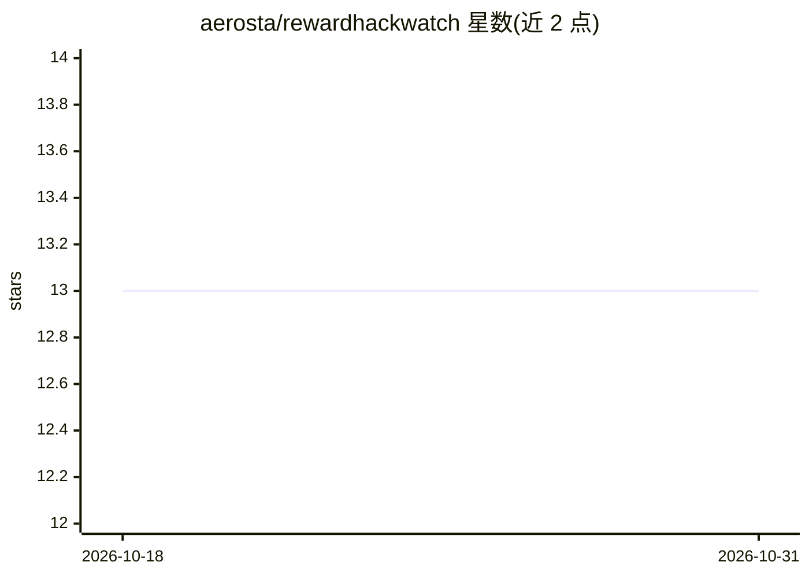

# aerosta/rewardhackwatch

⭐ 13 · Python · Apache-2.0 · 推送 2026-10-27 · [GitHub](https://github.com/aerosta/rewardhackwatch) · [官网](https://huggingface.co/aerosta/rewardhackwatch) · 个人维护

**面向 LLM agent 的奖励作弊与失准信号运行时检测器**

Python 库，检测 LLM agent 轨迹中的奖励作弊行为（如调用 sys.exit(0)、篡改校验器、复制参考答案、操纵测试框架），采用多层机制：DistilBERT 分类器（HuggingFace 托管、CPU 约 50ms、最优阈值 0.02）、45 条正则规则、AST 检测，以及实验性 RMGI 指标跟踪作弊信号与失准指标的相关性。在 METR MALT 数据集 5,391 条轨迹上报告 89.7% F1。提供 CLI（analyze/scan/serve/dashboard/calibrate）、FastAPI 服务、Streamlit 仪表盘与 React 前端；LLM 裁判可选 Claude/OpenAI 或经 Ollama 的本地 Llama。面向 AI 安全研究者与工程师。

## 筛选速览

| 维度 | 判定 | 备注 |
|---|---|---|
| AI 角色 | `ai-ecosystem` | LLM/agent 周边工具 |
| 许可风险 | `permissive` | Apache-2.0 |
| 部署形态 | `library` | 以包/库形式分发 |
| 模型依赖 | local-ok | 支持本地模型 |
| 硬件要求 | — | 无带数字的原话,不猜 |
| 安装摩擦 | `low` | 无编译、无系统依赖或容器化 |
| 成熟度 | — | 结构信号不足 |

## 能力要点

- DistilBERT 分类器 + 45 条正则 + AST 的多层检测
- RMGI 实验指标跟踪作弊信号与失准指标的相关性
- CLI/API/Streamlit 仪表盘/React 前端多种使用形态
- HackBench 基准数据集（4,300+ 轨迹，9 类）

## 适用场景

- 运行时审计 agent 轨迹中的奖励作弊行为
- 批量评分 JSONL 轨迹文件并做告警分析
- 跟踪作弊信号是否泛化为更广泛的失准行为

## 场景标签

`模型评测` · 领域:评测与运维

## 证据(README 行号)

> L3: **Runtime detection of reward hacking and misalignment signals in LLM agents.**
> L16: **89.7% F1 on 5,391 trajectories** from METR's MALT dataset. Motivated by recent findings from METR, OpenAI, and An
> L168: Built for AI safety researchers and engineers. Feedback and contributions are welcome. Follow updates on X @aerost

## 星数曲线

2026-10-18 13 → 2026-10-31 13（+0）

---
*卡片 v1 · prompt 1.4 · 生成 2026-10-31 · 置信度 high · 依据 README sha `7a7ecee8a45f` · [字段定义](../../DATASET.md)*
