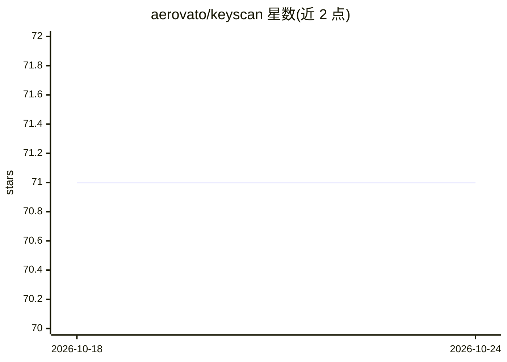

# aerovato/keyscan

⭐ 71 · Python · GPL-3.0 · 推送 2026-08-18 · [GitHub](https://github.com/aerovato/keyscan) · 个人维护

**扫描 GitHub Gist 泄露 API key 的 LLM 分类工具**

Python 实现的密钥暴露扫描器：通过 GitHub 网页搜索定位候选 gist，经 GitHub API 抓取内容，将候选文本行发送到用户自配置的 OpenAI 兼容端点（如 LM Studio、Llama.cpp、vLLM）做分类，模型输出 confidence 与 provider；再调用各服务商端点验证 key 是否有效，结果按 VALID/INVALID/UNKNOWN 分目录保存 JSON 记录。定位为防御性研究工具，条款限定仅限防御与教育用途，需自行配置端点与可选 GitHub token，从源码运行。

## 筛选速览

| 维度 | 判定 | 备注 |
|---|---|---|
| AI 角色 | `ai-native` | 本体是模型或模型工具 |
| 许可风险 | `viral` | GPL-3.0 |
| 部署形态 | `library` | 以包/库形式分发 |
| 模型依赖 | — | README 未给出锁定关系 |
| 硬件要求 | — | 无带数字的原话,不猜 |
| 安装摩擦 | `low` | 无编译、无系统依赖或容器化 |
| 成熟度 | — | 结构信号不足 |

## 能力要点

- 关键词列表批量扫描公开 Gist，可按文件类型过滤（默认 .env）
- 自带 LLM 端点做候选行分类，输出 confidence 与 provider
- 对发现 key 调用服务商端点验证，结果分目录结构化保存
- 可扩展文件类型模块与新增验证 provider，支持自定义分类 prompt

## 适用场景

- 安全研究员排查公开 Gist 中意外泄露的 API key
- 开发者自查自己泄露到 Gist 的凭据
- 防御性安全研究中的凭据暴露监测

## 场景标签

`网络安全` · 领域:学习与行业

## 证据(README 行号)

> L7: Keyscan: LLM-powered API key scanner.
> L9: Keyscan searches public GitHub Gists for exposed API keys and helps surface potential exposures for further review. 
> L91: 4. Classification: Each candidate line is sent to your configured OpenAI-compatible endpoint for classification. Th

## 星数曲线

2026-10-18 71 → 2026-10-24 71（+0）

---
*卡片 v1 · prompt 1.4 · 生成 2026-10-24 · 置信度 mid · 依据 README sha `e8866b947fc2` · [字段定义](../../DATASET.md)*
