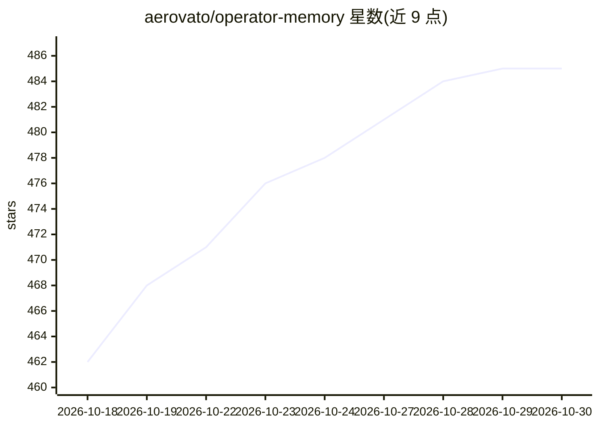

# aerovato/operator-memory

⭐ 485 · TypeScript · BSD-3-Clause · 推送 2026-10-27 · [GitHub](https://github.com/aerovato/operator-memory) · 个人维护 · 中文 README

**给编码 Agent 用的自改进上下文/记忆引擎，以 Markdown 沉淀项目知识**

面向编码 Agent（Claude Code、Codex、OpenCode、DeepSeek Harness 等）的上下文与记忆系统：以 Markdown 文档形式存储规格、决策、标准、研究与经验教训，分布在项目私有、项目共享与用户全局三个分区，通过会话内 Consult-Build-Update 循环自动更新，新会话从已有知识继续。无嵌入、无向量数据库、无后台 Agent，可用 Git 跟踪并团队共享文档。经 npm 安装 Operator Helper 后按 harness 安装适配器。冷启动时知识较稀疏，需 Agent 先撰写初始规格。

## 筛选速览

| 维度 | 判定 | 备注 |
|---|---|---|
| AI 角色 | `ai-ecosystem` | LLM/agent 周边工具 |
| 许可风险 | `permissive` | BSD-3-Clause |
| 部署形态 | `library` | 以包/库形式分发 |
| 模型依赖 | locked-api |  |
| 硬件要求 | — | 无带数字的原话,不猜 |
| 安装摩擦 | `low` | 无编译、无系统依赖或容器化 |
| 成熟度 | — | 结构信号不足 |

## 能力要点

- Markdown 文档形式的透明记忆（.operator/、.operator-shared/、~/.operator/user/ 三分区）
- 零基础设施：无嵌入、无向量数据库、无模型配置
- 支持 Claude Code、Codex、OpenCode、Pi、DeepSeek Harness、Kiro 等 7 种 harness 适配器
- 会话循环：Consult→Build→Update，知识随工作自动维护

## 适用场景

- 让编码 Agent 跨会话记住项目规格与决策，减少重复探索代码库
- 团队通过 Git 共享项目知识与标准
- 个人跨项目维护自己的规则与偏好知识

## 场景标签

`Agent 记忆` · 领域:Agent 开发

## 证据(README 行号)

> L7: Operator Memory gives your agent a brain for documenting all their work. As the agent works, it automatically docume
> L35: |Claude Code (CLI + Desktop)|🟢 Fully Supported|`operator-helper install claude-code`|

## 星数曲线

2026-10-18 462 → 2026-10-30 485（+23）

---
*卡片 v1 · prompt 1.4 · 生成 2026-10-21 · 置信度 high · 依据 README sha `6250f933cf22` · [字段定义](../../DATASET.md)*
