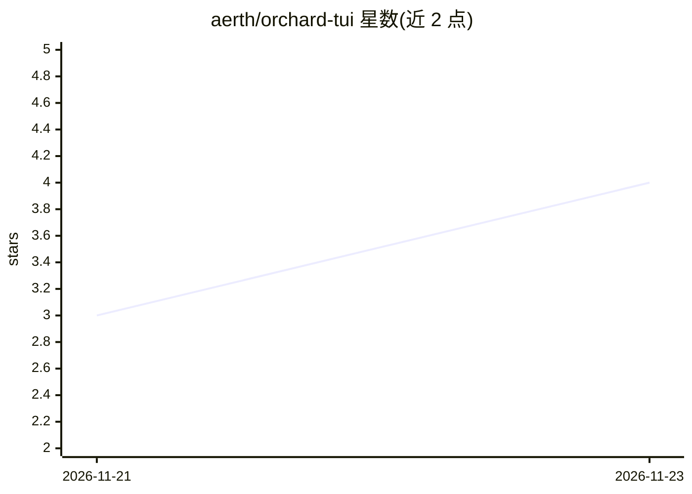

# aerth/orchard-tui

⭐ 4 · Go · NOASSERTION · 推送 2026-11-21 · [GitHub](https://github.com/aerth/orchard-tui) · [官网](https://github.com/aerth/orchard) · 个人维护

**终端里的 AI Agent 聊天界面，接本地/远程 LLM 执行工具**

Orchard AI Agent 的终端界面（BETA），以单个 Go 可执行文件运行：将 Markdown 渲染到终端，通过 LLM_HOST/LLM_MODEL 环境变量指定模型端点，启动时先生成问候语测试连通性。内置 run_bash 工具，可通过 ORCHARD_TOOLS 读取 bash 脚本目录动态扩展工具（脚本头注释即工具规范），并支持对指定工具要求确认。用 SQLite 持久化会话，按工作目录生成 thread ID；图片可附加但不入库。需 C 编译器编译 SQLite 部分。

## 筛选速览

| 维度 | 判定 | 备注 |
|---|---|---|
| AI 角色 | `ai-ecosystem` | LLM/agent 周边工具 |
| 许可风险 | `none` | NOASSERTION |
| 部署形态 | `library` | 以包/库形式分发 |
| 模型依赖 | local-ok | 支持本地模型 |
| 硬件要求 | — | 无带数字的原话,不猜 |
| 安装摩擦 | `medium` | 含编译或系统依赖之一 |
| 成熟度 | — | 结构信号不足 |

## 能力要点

- ORCHARD_TOOLS 目录中的 bash 脚本注释即工具规范，动态生成工具箱
- SQLite 持久化会话，按 $PWD 自动生成 thread ID
- -require-confirm 标志可要求对指定工具执行前确认
- 示例覆盖 ollama 与 llama.cpp 两种本地端点

## 适用场景

- 在终端里用本地模型对当前项目目录执行 bash 工具
- 用 bash 脚本自建工具箱（grep、web_search 等）扩展 agent 能力
- 按项目目录分组管理多线程会话历史

## 场景标签

`聊天机器人` `AI 助手` `编码 Agent` · 领域:编码与开发

## 证据(README 行号)

> L3: This is a **very basic** example of a terminal interface for Orchard AI Agent.
> L35: Minimally, `LLM_MODEL` and `LLM_HOST` is required. Without `ORCHARD_TOOLS`, a basic shell tool is the only tool ava
> L91: This program reads ORCHARD_TOOLS env to create a dynamic toolbox.

## 星数曲线

2026-11-21 3 → 2026-11-23 4（+1）

---
*卡片 v1 · prompt 1.4 · 生成 2026-11-22 · 置信度 high · 依据 README sha `87b4707ad6b0` · [字段定义](../../DATASET.md)*
