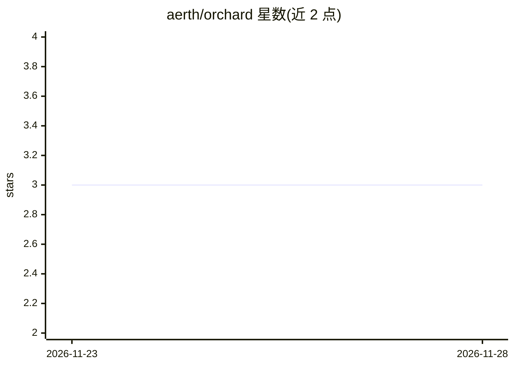

# aerth/orchard

⭐ 3 · Go · NOASSERTION · 推送 2026-11-27 · [GitHub](https://github.com/aerth/orchard) · [官网](https://github.com/aerth/orchard) · 个人维护

**Go 语言微型 AI agent 库：工具编排循环的执行框架**

用 Go 编写的极小体量 agent 库，核心是 CreateConvo 循环：反复调用工具直到完成，Hook 机制（PreText/PreTool/PostTool/NonText/Finish）允许应用自定义循环、向 UI 流式输出或确认工具调用。LLM 客户端由 mllm 包承担，持久化用 GORM 且可选。工具可用 Go、Bash 或 Python 实现，支持通过 ORCHARD_TOOLS 环境变量在运行时扫描动态工具箱，工具箱可含 .env 管理密钥。附带 TUI、io、tools 等示例，无遥测。

## 筛选速览

| 维度 | 判定 | 备注 |
|---|---|---|
| AI 角色 | `ai-ecosystem` | LLM/agent 周边工具 |
| 许可风险 | `none` | NOASSERTION |
| 部署形态 | `None` |  |
| 模型依赖 | local-ok | 支持本地模型 |
| 硬件要求 | — | 无带数字的原话,不猜 |
| 安装摩擦 | `low` | 无编译、无系统依赖或容器化 |
| 成熟度 | — | 结构信号不足 |

## 能力要点

- CreateConvo 工具调用循环，5 类 Hook 可定制行为
- Go/Bash/Python 三种方式实现工具，动态工具箱运行时扫描
- 专为本地 LLM 设计（ollama/llama.cpp），环境变量配置端点与模型
- 无遥测、无广告，持久化为可选 GORM(SQL)

## 适用场景

- 用 Go 快速搭建调用本地模型的工具编排 agent
- 为自己的应用嵌入可定制 Hook 的 agent 执行循环
- 以脚本目录方式管理带密钥的动态工具集

## 场景标签

`Agent 框架` · 领域:Agent 开发

## 证据(README 行号)

> L3: **tiny ai agent library** (tool orchestration, agentic harness)
> L14: Orchard is a very small **library** that provides `CreateConvo`, which runs a loop, calling tools until finished. T

## 星数曲线

2026-11-23 3 → 2026-11-28 3（+0）

---
*卡片 v1 · prompt 1.4 · 生成 2026-11-23 · 置信度 high · 依据 README sha `d599d1e50bb7` · [字段定义](../../DATASET.md)*
