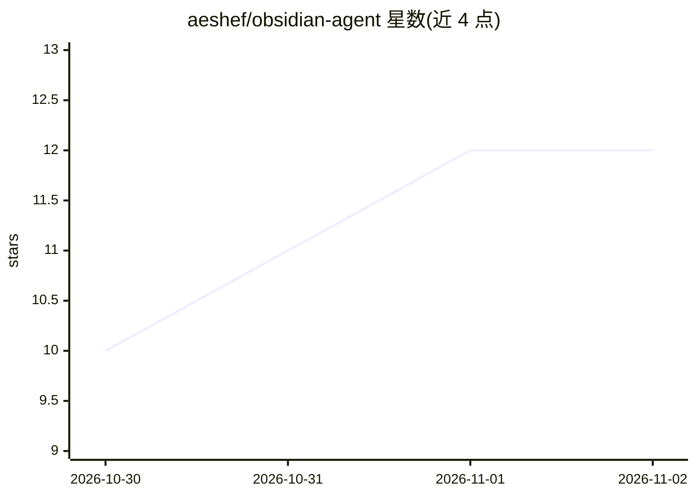

# aeshef/obsidian-agent

⭐ 12 · Python · MIT · 推送 2026-10-30 · [GitHub](https://github.com/aeshef/obsidian-agent) · [官网](https://github.com/aeshef/obsidian-agent#install-start-here) · 个人维护

**自托管的 Obsidian 个人 AI 助手 Telegram 机器人**

Python 编写的 Telegram bot，在本地 Obsidian vault 之上运行：从 Telegram 捕获文字、语音、照片、PDF 与链接写入 markdown/SQLite，用工具调用的 LLM 回答，覆盖三大模块——看板任务规划（planning）、笔记 RAG 知识库（knowledge）、个人记账（finance）。模块由 capabilities manifest 控制，关闭即从 UI/工具/提示/同步中移除（fail-closed）。LLM 通过 OpenAI 兼容接口接入（DeepSeek/OpenRouter/Groq/本地 vLLM 等）。安装支持 Cursor/Claude Code 引导、CLI 脚本或 Docker，需 Python 3.10–3.12、Telegram bot token 与 LLM API key。检索评测在私有标注集上 Recall@1/MRR 约 0.76，公开基线尚未发布。

## 筛选速览

| 维度 | 判定 | 备注 |
|---|---|---|
| AI 角色 | `ai-native` | 本体是模型或模型工具 |
| 许可风险 | `permissive` | MIT |
| 部署形态 | `self-host` | docker 或自建部署 |
| 模型依赖 | — | README 未给出锁定关系 |
| 硬件要求 | — | 无带数字的原话,不猜 |
| 安装摩擦 | `low` | 无编译、无系统依赖或容器化 |
| 成熟度 | — | 结构信号不足 |

## 能力要点

- Telegram 捕获（文字/语音 ASR/照片/PDF/链接）写入 vault 的 markdown/SQLite
- 三大模块：看板任务、笔记 RAG、记账账本，可跨域路由提问
- fail-closed capabilities manifest：关闭的模块从 UI、工具、提示与同步中完全移除
- OpenAI 兼容 LLM 接入（DeepSeek/OpenRouter/Groq/本地 vLLM），可选 Docker 与 VPS 24/7 运行

## 适用场景

- 通过 Telegram 快速记录任务、笔记和开支并归档进 Obsidian vault
- 对自己已有的笔记库做 RAG 问答与跨域查询（任务/知识/账本）
- 自托管一个可按需开关模块的个人 AI 助手

## 场景标签

`AI 助手` `RAG` `知识库管理` · 领域:对话与助手

## 证据(README 行号)

> L3: **Telegram bot for Obsidian** — a self-hosted AI agent / life OS over your local vault (tasks, notes RAG, personal f
> L14: Open-source **Obsidian + Telegram** personal assistant: capture from chat (text, voice, photos), write into markdow
> L38: 4. When it asks — paste tokens one at a time: BotFather bot token, then an **OpenAI-compatible** LLM key (DeepSeek,

## 星数曲线

2026-10-30 10 → 2026-11-02 12（+2）

---
*卡片 v1 · prompt 1.4 · 生成 2026-11-01 · 置信度 high · 依据 README sha `b5c282fa809d` · [字段定义](../../DATASET.md)*
