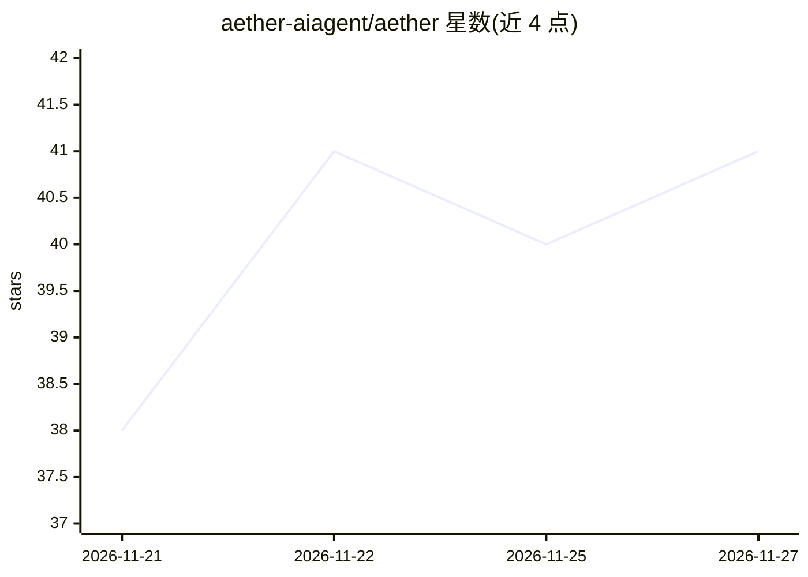

# aether-aiagent/aether

⭐ 41 · Kotlin · GPL-3.0 · 推送 2026-11-21 · [GitHub](https://github.com/aether-aiagent/aether) · [官网](https://aether-aiagent.github.io/aether/) · 个人维护

**Android 本地 AI Agent 应用：手机上运行带工具与本地 Linux 环境的 LLM 助手**

面向 Android 手机的开源 AI Agent 应用（Kotlin/Jetpack Compose，俄语界面）：对话之外提供 bash、文件读写/编辑、grep/find 等工具调用，经 proot 运行本地 Alpine 环境，可选 Termux 与 Shizuku（无 root 的 Agent Mode）集成，并支持 MCP 服务器、子代理与扩展。模型经 OpenAI 兼容 API 接入任意服务商（Anthropic、Gemini、本地模型），密钥存于 Android Keystore；除模型请求外数据均留在设备。官方签名 APK 发布，需 Android 8.0+ ARM64。

## 筛选速览

| 维度 | 判定 | 备注 |
|---|---|---|
| AI 角色 | `ai-native` | 本体是模型或模型工具 |
| 许可风险 | `viral` | GPL-3.0 |
| 部署形态 | `None` |  |
| 模型依赖 | local-ok | 支持本地模型 |
| 硬件要求 | — | 无带数字的原话,不猜 |
| 安装摩擦 | `medium` | 含编译或系统依赖之一 |
| 成熟度 | — | 结构信号不足 |

## 能力要点

- bash/文件/grep 等工具调用，经 proot 运行本地 Alpine Linux 环境，可选 Termux 集成
- MCP 服务器、子代理与扩展（Web Access、AI Lab 等）机制
- OpenAI 兼容 API 接入任意服务商，含本地 Ollama 与 LM Studio
- 签名 APK 发布，应用内自更新且不丢失聊天数据

## 适用场景

- 在手机上离线运行带命令行与文件工具的 AI 助手
- 无账号、无后端的前提下在本地使用自己的模型服务商
- 通过 Shizuku 无 root 自动化操作其他应用
- 在 Debian 桌面端使用同款 Agent（Aether Desktop）

## 场景标签

`AI 助手` `聊天机器人` · 领域:对话与助手

## 证据(README 行号)

> L29: **Aether** — AI-агент, который работает прямо на телефоне: читает и правит файлы, запускает команды,
> L36: > **Aether — AI agent for Android.** An open-source Android AI agent app (Kotlin, Jetpack Compose)
> L37: > that runs an LLM chat with real tools: bash, file read/write/edit, grep, find, ls, MCP servers,

## 星数曲线

2026-11-21 38 → 2026-11-27 41（+3）

---
*卡片 v1 · prompt 1.4 · 生成 2026-11-21 · 置信度 high · 依据 README sha `6ac2579ec822` · [字段定义](../../DATASET.md)*
