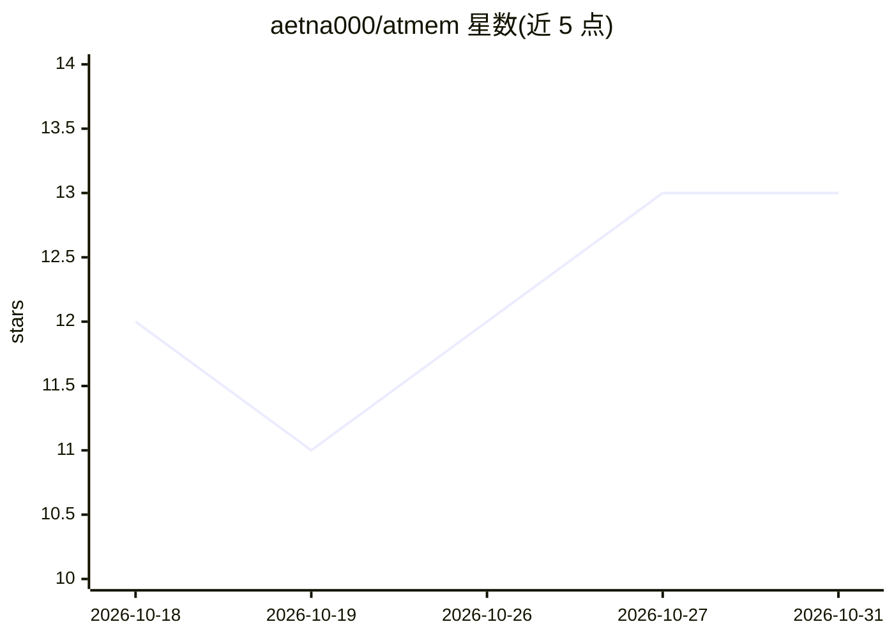

# aetna000/atmem

⭐ 13 · Python · Apache-2.0 · 推送 2026-10-30 · [GitHub](https://github.com/aetna000/atmem) · [官网](https://atmem.ai) · 个人维护

**面向 AI agent 的本地优先可审计记忆控制平面**

AtMem 是给 agent 运行时（OpenClaw、Pydantic AI、LangChain/LangGraph）提供治理式长期记忆与事件记录的 Python 包。机制：默认以影子模式启动，只记录不注入；操作员经 dashboard 审查后显式激活；记忆候选由 AtBot 提议排序，AtMem 独立授权、存储与删除。Agent Black Box 记录模型与工具事件，另有 Governed Task State 与可委托上下文提供方模式（含 Mem0 适配）。本地记忆无需外部 API，可选择 Ollama、本地 OpenAI 兼容模型或确定性回退。限制：需 Python 3.10+，首次 init 可能下载固定版本 Bun 运行时。

## 筛选速览

| 维度 | 判定 | 备注 |
|---|---|---|
| AI 角色 | `ai-ecosystem` | LLM/agent 周边工具 |
| 许可风险 | `permissive` | Apache-2.0 |
| 部署形态 | `library` | 以包/库形式分发 |
| 模型依赖 | local-ok | 支持本地模型 |
| 硬件要求 | — | 无带数字的原话,不猜 |
| 安装摩擦 | `medium` | 含编译或系统依赖之一 |
| 成熟度 | — | 结构信号不足 |

## 能力要点

- 影子模式默认开启，记忆注入需操作员显式激活，可随时回退
- Agent Black Box 记录记忆注入、模型边界与工具事件的证据链
- 本地优先：无外部 API 即可用本地记忆，支持 Ollama/本地 OpenAI 兼容模型/确定性回退
- 提供 OpenClaw/Pydantic AI/LangChain/LangGraph 适配与 24 项离线基准测试

## 适用场景

- 给我的 agent 框架接入可审计、可回滚的长期记忆
- 在允许注入前先审查 agent 将检索到哪些上下文
- 记录 agent 的模型与工具调用证据以满足审计需求

## 场景标签

`Agent 记忆` `LLM 可观测性` · 领域:Agent 开发

## 证据(README 行号)

> L11: AtMem: the memory control plane under every agent. Your agent runtime perceives, plans, acts and reflects; AtMem re
> L26: Install AtMem once and give OpenClaw, Pydantic AI, LangChain/LangGraph, or a

## 星数曲线

2026-10-18 12 → 2026-10-31 13（+1）

---
*卡片 v1 · prompt 1.4 · 生成 2026-10-31 · 置信度 high · 依据 README sha `430b6d6863e7` · [字段定义](../../DATASET.md)*
