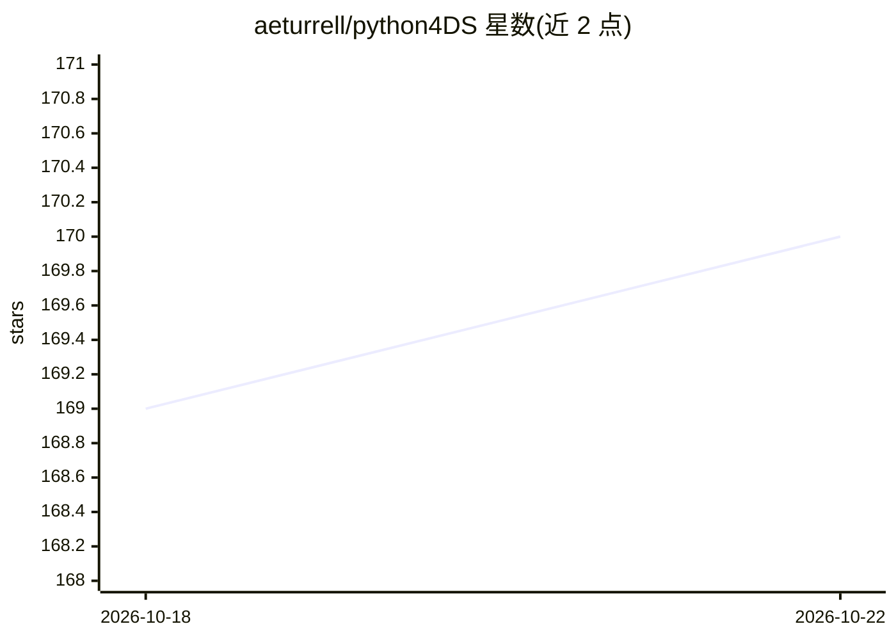

# aeturrell/python4DS

⭐ 170 · Jupyter Notebook · MIT · 推送 2026-08-16 · [GitHub](https://github.com/aeturrell/python4DS) · [官网](https://aeturrell.github.io/python4DS) · 个人维护

**教你用 Python 做数据科学的在线图书（含代码仓库）**

托管《Python for Data Science》在线图书的代码仓库，内容涵盖 Python 数据科学、机器学习与可视化教学，以 Markdown 与 Jupyter notebook 为源，用 Quarto 编译为 HTML 发布到网站。README 面向开发者与贡献者：本地开发需 Python 3.10 与 uv（uv sync 建环境），构建用 uv run quarto render --execute，发布流程含版本分支、pyproject 版本号与 GitHub Actions 自动构建上传及 Zenodo 归档；另提供 Dockerfile 供容器内开发。

## 筛选速览

| 维度 | 判定 | 备注 |
|---|---|---|
| AI 角色 | `ai-knowledge` | 知识聚合/清单类 |
| 许可风险 | `permissive` | MIT |
| 部署形态 | `self-host` | docker 或自建部署 |
| 模型依赖 | — | README 未给出锁定关系 |
| 硬件要求 | — | 无带数字的原话,不猜 |
| 安装摩擦 | `low` | 无编译、无系统依赖或容器化 |
| 成熟度 | — | 结构信号不足 |

## 能力要点

- 以 Quarto 从 markdown + Jupyter notebook 编译成书，freeze: auto 增量执行
- uv sync 一键创建 .venv 开发环境
- GitHub Actions 自动构建发布并创建 Zenodo 条目
- 提供 Dockerfile 支持容器内开发

## 适用场景

- 阅读在线书学习用 Python 做数据科学
- 为图书内容纠错或贡献章节
- 在自己的环境里构建和预览整本书

## 场景标签

`教程课程` · 领域:学习与行业

## 证据(README 行号)

> L5: This is the repo for **Python for Data Science**.
> L7: This README is for developers and contributors. If you're here to read the book, head over to https://aeturrell.gith

## 星数曲线

2026-10-18 169 → 2026-10-22 170（+1）

---
*卡片 v1 · prompt 1.4 · 生成 2026-10-22 · 置信度 high · 依据 README sha `117c4164cb7b` · [字段定义](../../DATASET.md)*
