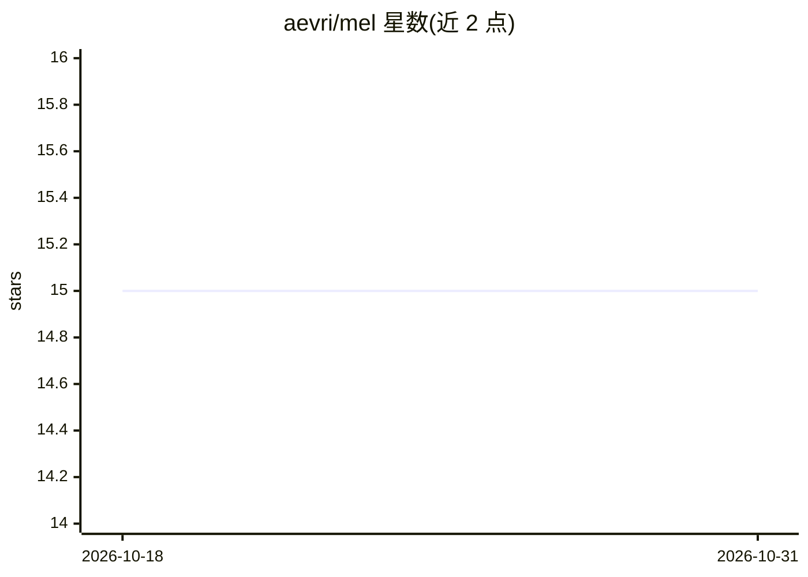

# aevri/mel

⭐ 15 · Python · Apache-2.0 · 推送 2026-04-15 · [GitHub](https://github.com/aevri/mel) · 个人维护

**追踪皮肤痣变化以辅助黑色素瘤早期发现的工具**

进行中的个人健康工具：通过维护痣目录（命名、识别图像、备注、UUID）和记录视觉历史来发现新增或变化的痣。提供两种技术路径：Roto-mapping 用旋转圆柱拍照法拍摄身体部位照片集，结合基础深度学习自动标注并将痣映射到 UUID；Microscope imaging 用 USB 显微镜拍摄并人工比对已知痣。还包含图像旋转与居中归一化以方便比较。需要 Python 3.8+，用 uv 从源码安装。

## 筛选速览

| 维度 | 判定 | 备注 |
|---|---|---|
| AI 角色 | `ai-native` | 本体是模型或模型工具 |
| 许可风险 | `permissive` | Apache-2.0 |
| 部署形态 | `library` | 以包/库形式分发 |
| 模型依赖 | — | README 未给出锁定关系 |
| 硬件要求 | — | 无带数字的原话,不猜 |
| 安装摩擦 | `low` | 无编译、无系统依赖或容器化 |
| 成熟度 | `idea` | |

## 能力要点

- 维护含 UUID、名称、识别图像与备注的痣目录
- Roto-mapping 用基础深度学习自动标注与映射痣到 UUID
- `mel rotomap` 与 `mel micro` 两套命令行工具
- 痣图像旋转与居中归一化便于时序比较

## 适用场景

- 我想长期记录身上的痣并发现新增或变化的痣
- 用手机和 USB 显微镜自拍比对痣的图像历史
- 按圆柱照片集方式给身体部位建立可对照的照片档案

## 场景标签

`目标检测` · 领域:感知与多模态

## 证据(README 行号)

> L3: Work-in-progress tools to help identify new and changing moles on the skin with
> L58: - **Roto-mapping**: Detect new moles with the `mel rotomap *` commands. Using the idea of 'photographing a rotating
> L60: - **Microscope imaging**: Detect changes in moles with the `mel micro *` commands. These help you quickly capture a

## 星数曲线

2026-10-18 15 → 2026-10-31 15（+0）

---
*卡片 v1 · prompt 1.4 · 生成 2026-10-30 · 置信度 high · 依据 README sha `6c46ddb1bfe0` · [字段定义](../../DATASET.md)*
