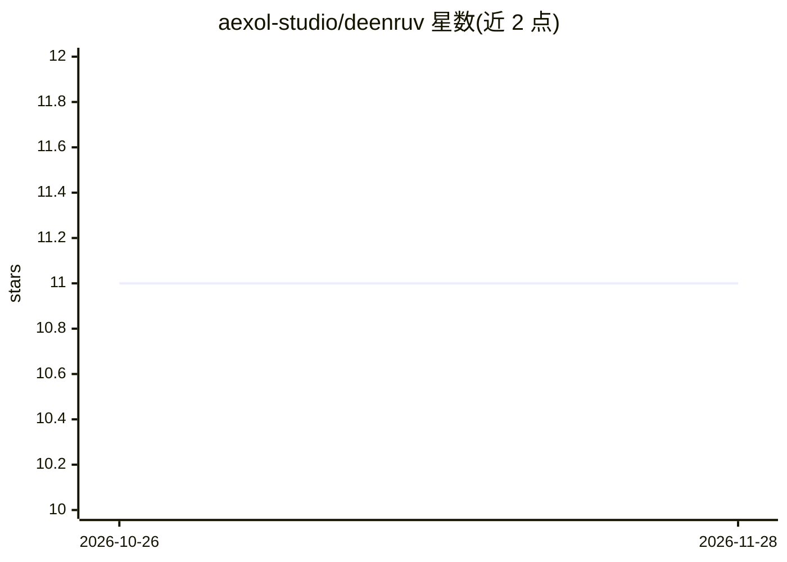

# aexol-studio/deenruv

⭐ 11 · TypeScript · NOASSERTION · 推送 2026-11-18 · [GitHub](https://github.com/aexol-studio/deenruv) · [官网](https://deenruv.com) · 组织维护

**开源 headless 电商框架：GraphQL API+React 管理后台+插件体系**

基于 NestJS 与 TypeORM 的 TypeScript 电商后端框架，提供 Shop/Admin 两套 GraphQL API、React+Tailwind 管理后台，以及 32+ 官方插件（支付、邮件、资产服务、Elasticsearch 搜索、任务队列、SEO 等）。支持多渠道与多语言、基于角色的访问控制、事件驱动邮件与资产管理。本地启动需 Node.js>=18、pnpm 与 Docker（Postgres/Redis/MinIO）。项目为 Vendure 的 2025 年 fork，MIT 许可。

## 筛选速览

| 维度 | 判定 | 备注 |
|---|---|---|
| AI 角色 | `ai-enhanced` | 去掉 AI 部分产品仍成立 |
| 许可风险 | `permissive` | NOASSERTION |
| 部署形态 | `library` | 以包/库形式分发 |
| 模型依赖 | — | README 未给出锁定关系 |
| 硬件要求 | — | 无带数字的原话,不猜 |
| 安装摩擦 | `low` | 无编译、无系统依赖或容器化 |
| 成熟度 | — | 结构信号不足 |

## 能力要点

- GraphQL-first：Shop API + Admin API 全类型化
- 32+ 官方插件，支持自定义插件扩展服务端与管理 UI
- React + Tailwind 管理后台，附带 UI SDK
- 多渠道、多语言、RBAC、任务队列与事件邮件

## 适用场景

- 搭建自有品牌的多渠道电商后端
- 通过插件扩展支付、搜索、邮件等电商能力
- 基于 GraphQL API 对接任意前端 storefront

## 场景标签

 · 领域:电子商务/开发框架

## 证据(README 行号)

> L3:  The headless commerce framework that gets out of your way.
> L11: Most commerce platforms force you into their way of doing things. Deenruv doesn't. It gives you a production-ready 

## 星数曲线

2026-10-26 11 → 2026-11-28 11（+0）

---
*卡片 v1 · prompt 1.4 · 生成 2026-11-18 · 置信度 low · 依据 README sha `6202c6836462` · [字段定义](../../DATASET.md)*
