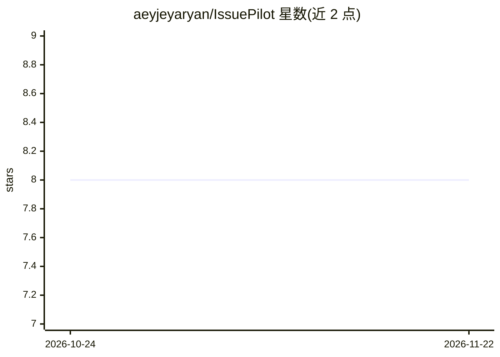

# aeyjeyaryan/IssuePilot

⭐ 8 · Python · MIT · 推送 2026-10-23 · [GitHub](https://github.com/aeyjeyaryan/IssuePilot) · 个人维护

**把 GitHub issue 转成已验证 PR 的本地 AI agent**

面向 Python 仓库的 issue-to-PR agent：读取 issue、用本地检索栈定位相关代码、编写必须先失败复现测试、草拟修复、在隔离沙箱中运行测试套件、在分支上开启 PR。九步流程由 LangGraph 状态机编排，步骤 5-7 失败时最多重试 3 次，每次重试从原始快照重启。全部本地运行：模型走 Ollama，向量库用 ChromaDB/FAISS，测试在无网络的 Docker 沙箱执行，提供 CLI、FastAPI Web UI（SSE 流式日志）与 HTTP API。仅支持 Python 仓库；沙箱镜像需先构建一次。

## 筛选速览

| 维度 | 判定 | 备注 |
|---|---|---|
| AI 角色 | `ai-native` | 本体是模型或模型工具 |
| 许可风险 | `permissive` | MIT |
| 部署形态 | `self-host` | docker 或自建部署 |
| 模型依赖 | local-ok | 支持本地模型 |
| 硬件要求 | — | 无带数字的原话,不猜 |
| 安装摩擦 | `low` | 无编译、无系统依赖或容器化 |
| 成熟度 | — | 结构信号不足 |

## 能力要点

- 复现测试必须先失败：通过的测试会被拒绝并重新请求模型
- 不可信代码仅在 Docker 沙箱运行：无网络、只读文件系统、资源限制与硬超时
- 永不推送默认分支：fork → branch → commit → PR，支持 --dry-run
- 本地 Ollama 模型 + 本地向量库 + Docker，无云端服务

## 适用场景

- 自动为 Python 仓库的 issue 生成带复现测试的修复 PR
- 在离线/本地环境运行 issue 修复流水线
- 用 --dry-run 在 CI 中预演修复流程

## 场景标签

`编码 Agent` · 领域:编码与开发

## 证据(README 行号)

> L5: IssuePilot is an open-source issue-to-PR agent for Python repositories. It reads
> L78: Nine steps, orchestrated by a LangGraph state machine. Every step emits events
> L257: * **Only Python is supported.** The chunker, the test runner and the sandbox

## 星数曲线

2026-10-24 8 → 2026-11-22 8（+0）

---
*卡片 v1 · prompt 1.4 · 生成 2026-11-20 · 置信度 mid · 依据 README sha `d0826106a191` · [字段定义](../../DATASET.md)*
