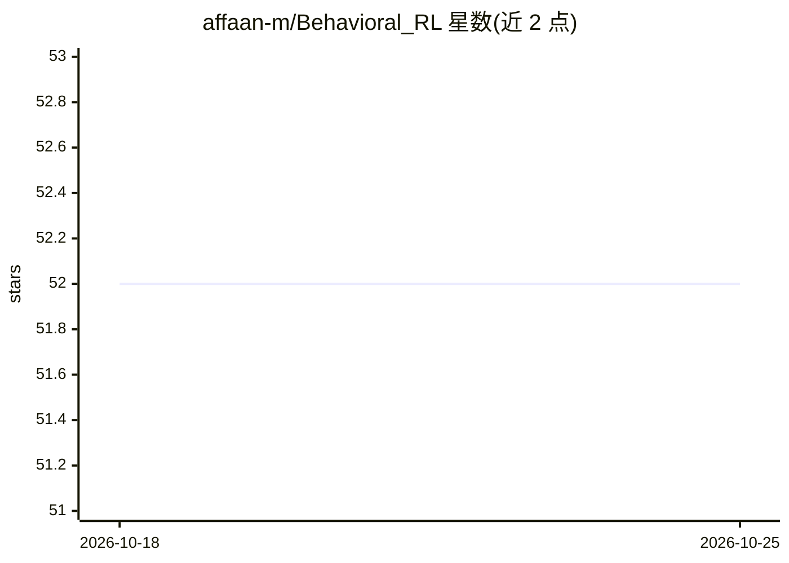

# affaan-m/Behavioral_RL

⭐ 53 · HTML · 推送 2026-06-04 · [GitHub](https://github.com/affaan-m/Behavioral_RL) · 个人维护

**风险敏感强化学习建模 Iowa 赌博任务中的人类决策**

基于 PyTorch 的强化学习研究项目：实现自定义 Iowa Gambling Task（IGT）环境（遵循 OpenAI Gym 接口与 Bechara 等 1994 年实验参数），并在 DQN 基线上引入前景理论价值函数与 CVaR 风险度量，构建风险敏感模型以复现人类风险规避决策模式。训练分探索/利用两阶段共 200 次，报告风险敏感模型的牌堆选择比例更接近人类数据。依赖 PyTorch、Gymnasium 等，MIT 许可。

## 筛选速览

| 维度 | 判定 | 备注 |
|---|---|---|
| AI 角色 | `ai-native` | 本体是模型或模型工具 |
| 许可风险 | `none` | — |
| 部署形态 | `None` |  |
| 模型依赖 | — | README 未给出锁定关系 |
| 硬件要求 | — | 无带数字的原话,不猜 |
| 安装摩擦 | `low` | 无编译、无系统依赖或容器化 |
| 成熟度 | — | 结构信号不足 |

## 能力要点

- 自定义 IGT 环境，奖惩结构与 Bechara 等 (1994) 实验参数一致
- DQN 中嵌入前景理论价值函数（α/β=0.88，损失厌恶 λ=2.25）
- Q 值计算引入 CVaR 风险度量（窗口 20 次，风险敏感度 0.7）
- 风险敏感模型的牌堆选择比例与人类基线数据对照报告

## 适用场景

- 研究人类决策偏差的风险敏感强化学习建模
- 复现 Iowa Gambling Task 上的计算认知实验
- 对比标准 DQN 与风险敏感模型的行为差异

## 场景标签

 · 领域:机器学习/行为决策研究

## 证据(README 行号)

> L3: This project implements a risk-sensitive reinforcement learning approach to model human decision-making behavior in 
> L64:  - Modified DQN incorporating prospect theory value function

## 星数曲线

2026-10-18 52 → 2026-10-25 52（+0）

---
*卡片 v1 · prompt 1.4 · 生成 2026-10-24 · 置信度 high · 依据 README sha `a051d7865faf` · [字段定义](../../DATASET.md)*
