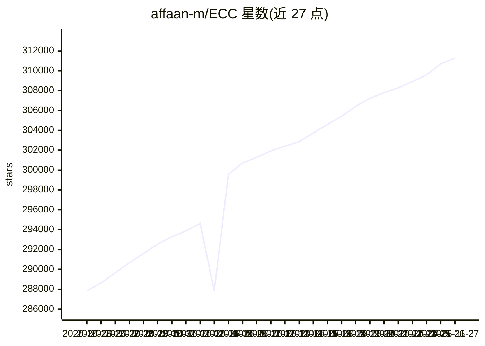

# affaan-m/ECC

⭐ 311,272 · JavaScript · MIT · 推送 2026-11-23 · [GitHub](https://github.com/affaan-m/ECC) · [官网](https://ecc.tools) · 个人维护

**为 AI 编码 agent 提供 72 agents/328 skills 的工程化协调系统**

ECC 是面向 Claude Code、Codex 等编码 agent 的插件与运行时增强层：提供计划-测试-实现-审查-验证-记忆的开发流程、72 个专项 agents（规划、审查、构建修复、安全、架构）、328 个 skills、hooks、规则包、记忆与持续学习机制，并附带 AgentShield 对 prompts、hooks、MCP 配置、权限与密钥的扫描。通过 npm 包 ecc-universal 引导安装或 Claude 原生插件命令安装，MIT 许可；ECC Pro 为私有仓库的托管 GitHub App（按席位收费）。

## 筛选速览

| 维度 | 判定 | 备注 |
|---|---|---|
| AI 角色 | `ai-ecosystem` | LLM/agent 周边工具 |
| 许可风险 | `permissive` | MIT |
| 部署形态 | `library` | 以包/库形式分发 |
| 模型依赖 | — | README 未给出锁定关系 |
| 硬件要求 | — | 无带数字的原话,不猜 |
| 安装摩擦 | `low` | 无编译、无系统依赖或容器化 |
| 成熟度 | — | 结构信号不足 |

## 动量与使用信号

- 维护:`active` — 距上次 push 2.5 天,年发版 19,412 位贡献者
- 涨星:近 1 天 **+1,474**(自 20261016 起算)
- 下载:GitHub Release 附件 累计 89,501(19 个 release)
- 平台:— · 协议:OPENAI-API / MCP

## 能力要点

- 72 个 agents、328 个 skills、99 个命令与 hooks/memory 运行时
- AgentShield 扫描 prompts、hooks、MCP 配置、权限、secrets 与 agent 文件
- npm 引导安装支持 Claude Code、Codex、Kimi Code 多 harness
- MIT 开源，另有托管 Pro 版

## 适用场景

- 让编码 agent 在固定工程流程（计划/测试/审查/记忆）下工作
- 为 Claude Code 或 Codex 批量安装技能、命令与规则包
- 扫描 agent 相关配置中的安全风险与密钥泄露

## 场景标签

`编码 Agent` `网络安全` `代码审查` · 领域:编码与开发

## 证据(README 行号)

> L109: ECC is MIT-licensed open source. It works best with Claude Code today, has native Codex and Qoder plugin paths, an
> L111: Access to 72 agents, 328 skills, and 99 legacy command shims, plus hooks, rules, memory, continuous learning, and 
> L99: Your agent can write code, but ECC gives it a coordinated engineering system and toolbox: it plans before it builds

## 星数曲线

2026-10-25 287,847 → 2026-11-27 311,272（+23,425）

---
*卡片 v1 · prompt 1.4 · 生成 2026-11-22 · 置信度 high · 依据 README sha `99d87d288596` · [字段定义](../../DATASET.md)*
