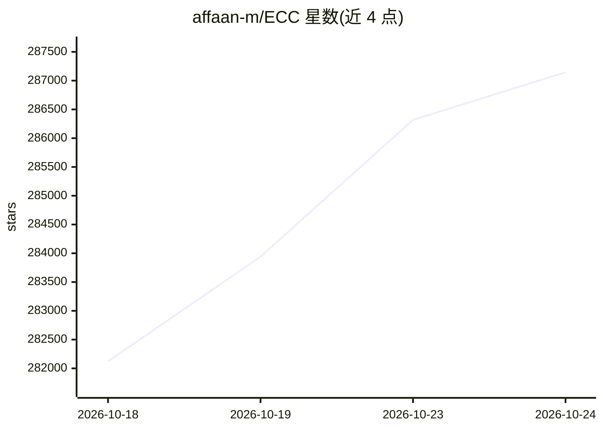

# affaan-m/ECC

⭐ 287,847 · JavaScript · MIT · 推送 2026-10-20 · [GitHub](https://github.com/affaan-m/ECC) · [官网](https://ecc.tools) · 个人维护

**为 Claude Code 等 AI 编码 harness 安装 agent 工程系统的插件**

ECC 是面向 AI 编码代理的开源 harness 系统，以 Claude Code 插件（ecc@ecc）和 npm 包（ecc-universal）形式分发，提供 71 个 agent、311 个技能、97 个命令、hooks、规则包、记忆与持续学习机制，以及 AgentShield 安全扫描（扫描 prompts、hooks、MCP 配置、权限、密钥）。项目按 plan→test→implement→review→verify→remember→improve 流程组织。对 Claude Code 提供引导式插件安装，Codex 与 Kimi Code 有引导路径，Cursor、OpenCode、Gemini、Zed、GitHub Copilot、Qwen 等通过能力受限的适配器支持；README 注明需查看支持状态矩阵，不保证功能对等。MIT 许可，另有面向私有仓库的托管 Pro 版 GitHub App。

## 筛选速览

| 维度 | 判定 | 备注 |
|---|---|---|
| AI 角色 | `ai-native` | 本体是模型或模型工具 |
| 许可风险 | `permissive` | MIT |
| 部署形态 | `library` | 以包/库形式分发 |
| 模型依赖 | — | README 未给出锁定关系 |
| 硬件要求 | — | 无带数字的原话,不猜 |
| 安装摩擦 | `low` | 无编译、无系统依赖或容器化 |
| 成熟度 | — | 结构信号不足 |

## 动量与使用信号

- 维护:`active` — 距上次 push 2.5 天,年发版 19,412 位贡献者
- 涨星:近 1 天 **+1,474**(自 20261016 起算)
- 下载:GitHub Release 附件 累计 89,501(19 个 release)
- 平台:— · 协议:OPENAI-API / MCP

## 能力要点

- 71 个 agent、311 个技能与 97 个命令的插件化分发
- AgentShield 扫描 prompts、hooks、MCP 配置、权限与密钥
- hooks、记忆、会话摘要与持续学习等运行时机制
- 提供 npx/pnpm/yarn/bun 引导式安装与 dry-run 预检

## 适用场景

- 为 Claude Code 或 Codex 安装统一的计划-测试-审查工作流
- 扫描 agent 相关配置中的密钥与权限风险
- 把反复成功的做法沉淀为可复用的技能与规则包

## 场景标签

`编码 Agent` `网络安全` · 领域:编码与开发

## 证据(README 行号)

> L98: Your agent can write code, but ECC gives it a coordinated engineering system and toolbox: it plans before it builds
> L108: ECC is MIT-licensed open source. It works best with Claude Code today, has native Codex and Qoder plugin paths, an
> L110: Access to 71 agents, 311 skills, and 97 legacy command shims, plus hooks, rules, memory, continuous learning, and 

## 星数曲线

2026-10-18 282,122 → 2026-10-24 287,146（+5,024）

---
*卡片 v1 · prompt 1.4 · 生成 2026-10-18 · 置信度 high · 依据 README sha `025a818f0cac` · [字段定义](../../DATASET.md)*
