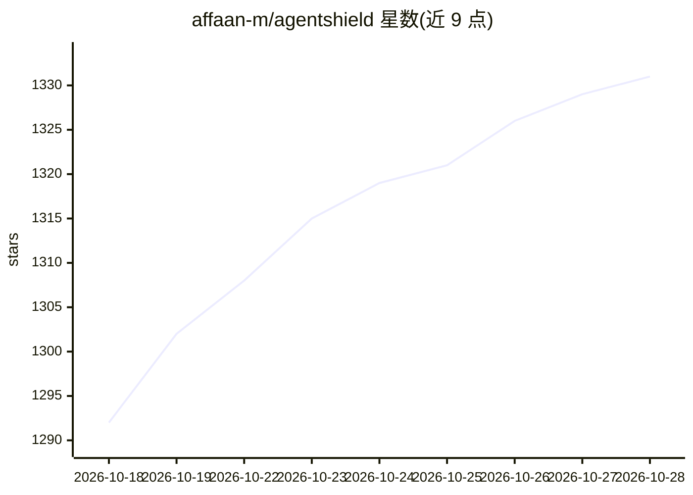

# affaan-m/agentshield

⭐ 1,335 · TypeScript · MIT · 推送 2026-10-18 · [GitHub](https://github.com/affaan-m/agentshield) · [官网](https://cerebralvalley.ai/e/claude-code-hackathon) · 个人维护

**AI agent 配置安全扫描器：审计 Claude Code 配置与 MCP 风险**

扫描 `.claude/` 目录的 CLI 安全审计工具，检测硬编码密钥、通配符权限、hook 命令注入、MCP 服务器风险（npx -y 自动安装、远程传输、明文密钥）与提示注入向量。268 条规则分 15 个模块，按严重度扣分输出 A-F 评级报告，识别到的防御配置仅列出不扣分；区分 active-runtime 与模板/示例来源的置信度标注。以 npm 包提供，另有 GitHub Action 与 GitHub App 形式，含供应链核验与包管理器加固检查。

## 筛选速览

| 维度 | 判定 | 备注 |
|---|---|---|
| AI 角色 | `ai-ecosystem` | LLM/agent 周边工具 |
| 许可风险 | `permissive` | MIT |
| 部署形态 | `self-host` | docker 或自建部署 |
| 模型依赖 | — | README 未给出锁定关系 |
| 硬件要求 | — | 无带数字的原话,不猜 |
| 安装摩擦 | `low` | 无编译、无系统依赖或容器化 |
| 成熟度 | — | 结构信号不足 |

## 能力要点

- 268 条规则 / 15 个模块，输出 A-F 评级与 0-100 分报告
- 密钥、权限、hook 注入、MCP 服务器、提示注入五类检测
- findings 携带 runtimeConfidence 区分活动配置与模板/示例
- 供应链核验（--supply-chain）与 npm/Yarn/pnpm 加固检查

## 适用场景

- 安装社区技能或接入 MCP 前审计我的 Claude Code 配置
- CI 中用 GitHub Action 拦截含密钥或危险权限的配置变更
- 核验仓库自带的 MCP 模板是否含风险定义

## 场景标签

`网络安全` · 领域:学习与行业

## 证据(README 行号)

> L7: Scans Claude Code setups for hardcoded secrets, permission misconfigs,
> L33: Developers install community skills, connect MCP servers, and configure hooks without any automated way to audit th

## 星数曲线

2026-10-18 1,292 → 2026-10-28 1,331（+39）

---
*卡片 v1 · prompt 1.4 · 生成 2026-10-21 · 置信度 mid · 依据 README sha `18658907cb5f` · [字段定义](../../DATASET.md)*
