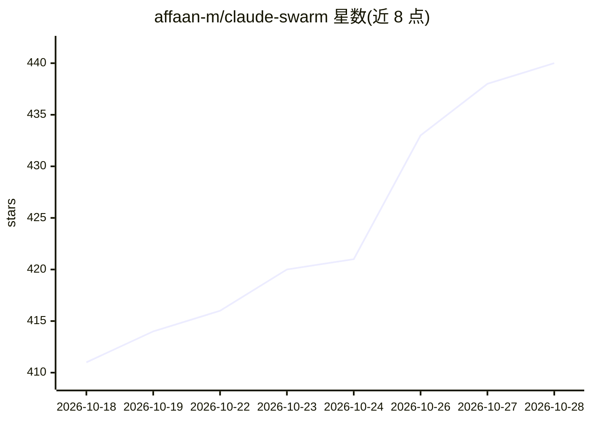

# affaan-m/claude-swarm

⭐ 440 · Python · MIT · 推送 2026-02-11 · [GitHub](https://github.com/affaan-m/claude-swarm) · 个人维护

**Claude Code 的多 agent 编排工具：任务分解、并行执行与终端可视化**

基于 Claude Agent SDK 构建的命令行多 agent 编排系统，面向使用 Claude Code 的开发者。用户描述复杂任务后，由 Opus 模型分析代码库并将任务拆解为依赖图子任务，Haiku worker agent 并行执行，完成后经 Opus 质量门审查。提供文件冲突检测、预算硬限制、成本追踪、htop 风格 Rich 终端面板、JSONL 会话记录与回放、YAML 声明式拓扑配置，另有无需 API key 的演示模式。为 Claude Code Hackathon 作品。

## 筛选速览

| 维度 | 判定 | 备注 |
|---|---|---|
| AI 角色 | `ai-ecosystem` | LLM/agent 周边工具 |
| 许可风险 | `permissive` | MIT |
| 部署形态 | `library` | 以包/库形式分发 |
| 模型依赖 | locked-api |  |
| 硬件要求 | — | 无带数字的原话,不猜 |
| 安装摩擦 | `low` | 无编译、无系统依赖或容器化 |
| 成熟度 | — | 结构信号不足 |

## 能力要点

- 任务拆解为依赖图子任务，独立任务并行执行
- 悲观文件锁冲突检测与预算硬限制、实时成本追踪
- Opus 质量门审查各 agent 合并输出
- htop 风格终端面板、会话记录与回放、swarm.yaml 声明式配置

## 适用场景

- 把大型重构或开发任务拆给多个 agent 并行完成
- 在终端实时监控多个 agent 的进度、成本与文件冲突
- 回放 swarm 执行过程以审查各 agent 操作

## 场景标签

`多智能体` `Agent 框架` `编码 Agent` · 领域:Agent 开发

## 证据(README 行号)

> L8: **Multi-agent orchestration for Claude Code** — decompose complex tasks into parallel subtasks, coordinate agents in
> L22: 2. **Parallel Agent Spawning** — Independent subtasks run simultaneously via Claude Agent SDK. Dependent tasks wait
> L103: - **claude-agent-sdk** (v0.1.35+) for Claude Code subprocess control

## 星数曲线

2026-10-18 411 → 2026-10-28 440（+29）

---
*卡片 v1 · prompt 1.4 · 生成 2026-10-21 · 置信度 high · 依据 README sha `2538f79de14f` · [字段定义](../../DATASET.md)*
